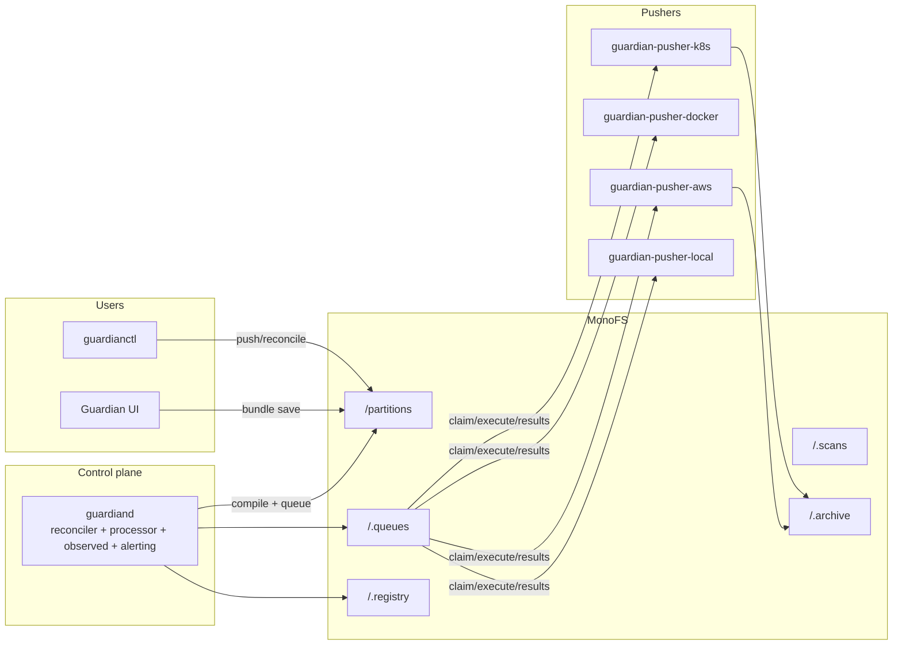

# Guardian Architecture

> Written from the current source tree. Supersedes earlier design notes where
> they disagree with the code.

## 1. Overview

Guardian is a **declarative deployment control plane** for a fleet of
"pushers". Desired state lives in MonoFS as a `guardian/` namespace; Guardian
compiles it into typed assets, computes drift, and queues tasks; pusher
binaries claim tasks and execute DIFF → CHECK → APPLY (or DESTROY) against
Kubernetes, Docker, AWS, or an in-process local backend.

Guardian has no database and no direct socket to its workers. **MonoFS is the
database and the message bus**: partitions, intents, state, queues, archives,
and the platform registry are all files in the store.



## 2. Domain Model

### 2.1 Partition

A partition (`internal/domain/partition`) is the unit of ownership:

- `metadata.name`
- `spec.deletionPolicy`: `orphan` | `destroy`
- `spec.reconciliation.mode`: `auto` | `manual` | `readonly`, with `interval`
  (Go duration or quartz cron) and `jitterPercent`
- `spec.defaults.targetPusher` / `target` for its intents

Partition status is **derived**, not stored: `Invalid`, `Failing`, `Attention`,
`Progressing`, `Healthy`, with display labels for the UI
(`internal/domain/state/partition_status.go`).

### 2.2 Intent

An intent (`internal/domain/intent`) is a deployable unit:

- `spec.intentType`:
  - `standard` — full DIFF → CHECK → APPLY lifecycle
  - `observed` — AWS-only, report-only; never queues APPLY, never mutates
- `spec.implementation`:
  - `native` — provider-native drivers (default)
  - `cdk` — all CDK-expressible assets compile into one generated TypeScript
    CDK stack per intent
- `joins` — intent-level DAG; `dependsOn` on assets for intra-intent ordering
- `target` — cluster/namespace/region/account placement
- `locked` (freeze at drift), `hints`, and `assets`

### 2.3 Assets

Public asset types (`internal/domain/asset/catalog.go`): `Compute`,
`ImageBuild`, `CDKStack`, `Database`, `SQLDatabase`, `Volume`, `Config`,
`Network`, `Secret`, `LoadBalancer`, `TraefikRoute`, `ObjectStore`,
`Observability`, `K8sResource`. Internal-only: `AWSResource` (raw CFN
fallback) and `GeneratedStack` (the compiled CDK stack carried through the
task pipeline).

Each asset spec has `type, name, version, dependsOn, flowMetricGroups, hints,
payload, properties, skip`. Typed payload schemas and UI builder metadata live
in `internal/domain/assets/`.

### 2.4 Tasks and results

Task ops: `CHECK | DIFF | APPLY | DESTROY` (`internal/domain/task`). A task
carries partition/intent IDs, revisions, asset version IDs, abstract assets,
target, and `forceApply`. Results carry `DriftReport`, `HealthObservation`,
`ApplyReadiness`, `AssetObservations`, outputs, and logs.

### 2.5 Intent state machine

`internal/domain/state/state.go`:

```
Invalid → Blocked → Ready → Checking → Diffing → Applying → Healthy
                    ↘ CheckFailed  ↘ DiffFailed  ↘ ApplyFailed
        Drifted / DriftedLocked
        Destroying → Destroyed / Orphaned
        Observed / ObservedDrifted (report-only intents)
```

A **rollout** is a spec-hash change on an applied intent: the reconciler
queues CHECK instead of DIFF, producing a new `DeploymentRevision` and a
`ReleaseRecord`. **Rollback** on failed DIFF/CHECK/APPLY is *recorded* (with
`rollbackTo`/`rollbackReason` and a `rollback.triggered` event) and the pushed
manifest is deliberately preserved so the next reconcile retries it; operators
can also restore archived manifests per tag
(`guardianctl partition rollback --tag|--previous`).

## 3. Components

### 3.1 guardiand (`cmd/guardiand`)

Long-running control plane. Starts:

- **Reconciler** (`internal/orchestrator/reconciler`) — full and per-partition
  cycles, quartz-based scheduling, priority pool.
- **Partition watcher** (`internal/orchestrator/watcher`) — debounced store
  watch; forces reconcile on change; full reconcile on reconnect.
- **Result processor** (`internal/orchestrator/results`) — 8 workers with
  partition-affinity hashing (preserves per-partition ordering) plus a
  periodic safety-net scan.
- **Observed collector** (`internal/observed`) — polls pusher read APIs for
  report-only AWS intents and writes `.observed` snapshots.
- **Alerting evaluator** (`internal/alerting`) — partition failure/recovery
  notifications.
- **UI/API server** (`internal/ui`) — HTTP API + embedded UI.

Key flags/env: `--config`, `--reconcile-interval` (default `10m`),
`--ui-listen`, OIDC settings, `--authz-grants-path`, `--authz-enforce-deploy`;
`GUARDIAN_STALE_TASK_AFTER` (default 30m), `GUARDIAN_PUSHERS`,
`GUARDIAN_OBSERVED_*`, `GUARDIAN_ENABLE_FLOW_TOPOLOGY`, `GUARDIAN_OTEL_*`.

### 3.2 guardianctl (`cmd/guardianctl`)

Operator CLI. Connects via MonoFS directly, via a local store dir, or via
Guardian discovery (`GET /api/client-config`). Command groups:

- `auth login|logout|whoami` (OIDC device flow, cached token)
- `partition init|set-config|push|reconcile|rollback|status|wait|list|get|delete|tag|tags|validate-local`
- `intent put|delete|list|validate|plan|status|describe|outputs|lock|unlock`
- `asset catalog|describe`, `template list`
- `store tree|read|delete`, `filesystem tree|read`
- `pusher add|list|remove`, `repo add|list|remove|assign|sync|ingest|apply|notify|import`
- `aws setup|init|pusher-deploy|scan|observed-generate|unmanaged|ecr-login`
- `image build|push|release|stamp`, `release run`
- `dev setup|build|deploy|init|stop|destroy|status|stamp-urls|configure-registry`
- `notify test`

### 3.3 Pushers

All pushers share the same runtime contract
(`internal/pusher/runtime/runtime.go`):

- Poll their queue directory (default 5s).
- Claim tasks by CAS-creating `.claims/<taskID>.json` with a 5-minute lease;
  expired claims are reclaimed.
- Execute with `--max-concurrency`; optional task-ID-hash sharding
  (`--shard-index/--shard-count`).
- Write `.results/<taskID>.json`.
- Retry unclaimed tasks after `--unclaimed-task-retry-delay` (15s default).

| Pusher | Backend |
| --- | --- |
| `guardian-pusher-k8s` | Kubernetes API via client-go (preferred) or kubectl (`--backend auto|client|kubectl`) |
| `guardian-pusher-docker` | docker CLI against `--cluster`, staged state dir, `--docker-add-hosts` |
| `guardian-pusher-aws` | CDK CLI + AWS SDK composite backend; also runs the scan runner, the read API (`:19090` default), and the CloudFormation event consumer |
| `guardian-pusher-local` | In-process reference drivers (Compute, Database) for dev/dogfood |
| `guardian-docker` | Standalone inspection CLI (`generate`, `diff`) for guardian-labelled Docker resources |

Every pusher registers with MonoFS as principal `guardian-pusher-<name>`
(role `pusher`) unless overridden.

### 3.4 Driver contract

`internal/pusher/registry`:

```go
type AssetDriver interface {
    Type() string
    Validate(props map[string]any) error
    Check(ctx, AssetInput) error
    Diff(ctx, AssetInput) (DriftReport, error)
    Apply(ctx, AssetInput) (AssetResult, error)
    Destroy(ctx, AssetInput) error
}
```

Optional interfaces: `ObservedStateDriver.ObserveState` (health/readiness) and
`ContextValidator.ValidateInContext` (cross-asset validation, preferred over
`Validate` when implemented). Drivers exist for Kubernetes, Docker, AWS, and
local.

## 4. Store Layout

Canonical logical paths (`internal/paths/paths.go`), mapped by the MonoFS
adapter to physical paths (`/partitions` → `guardian/`):

| Logical path | Purpose |
| --- | --- |
| `/partitions/<p>/config.yaml` | partition spec |
| `/partitions/<p>/intents/<intent>.yaml` | desired intent manifests |
| `/partitions/<p>/payloads/aws-generated/<intent>/` | generated CDK app |
| `/partitions/<p>/.state/partition.json` | partition state/errors |
| `/partitions/<p>/.state/intents/<intent>.json` | per-intent runtime state (authoritative) |
| `/partitions/<p>/.state/assets/<intent>--<asset>.json` | asset-level state |
| `/partitions/<p>/.state/events/<eventID>.json` | event log |
| `/partitions/<p>/.state/releases.json` | per-partition release log |
| `/partitions/<p>/.state/notifications.json` | alerting state |
| `/partitions/<p>/.observed/<intent>/...` | observed snapshots + events |
| `/partitions/<p>/secrets/**` | secret refs (`monofs-secret://`) |
| `/partitions/<p>/.deletion.json` | deferred deletion marker |
| `/.registry/pushers/<name>.json`, `/.registry/repos/<name>.json` | platform registry |
| `/.queues/<pusher>/<taskID>.json` (+ `.claims/`, `.results/`) | task queue |
| `/.scans/<pusher>/requests|.claims|.results/` | AWS scan queue |
| `/.archive/<p>/<intent>/<deployment>/` | manifest/state/logs + `index.json` |
| `/.templates/aws/**` | CDK template overlays (global + per-partition) |
| `/.repos/<display-path>/**` | read-only view of ingested repos |

**Store backends** (`pkg/guardianapi`): MonoFS adapter (gRPC, client
registration/heartbeat, watch with physical→logical remap), filesystem
(versioned blobs), and in-memory (tests). All writes carry
`MutationContext{principalID, reason, correlationID}`; writes/deletes support
`ExpectedVersionID` optimistic concurrency (`"absent"` = create-only) and
return `ErrConflict` on races.

There is **no persisted runtime aggregate**: `LoadPartitionRuntime` derives
status by scanning `.state/partition.json` plus `.state/intents/*.json`. Older
docs describing a `runtime.json` are obsolete. The dispatcher keeps an
in-memory runtime + release-log cache with O(1) metric deltas and write
suppression.

## 5. Control Loop

### 5.1 Push → compile

1. `guardianctl partition push --dir` (or the UI `PUT /api/partitions/<p>/bundle`)
   loads config + intents, runs `planner.Compile` locally, then writes with
   optimistic concurrency; unchanged bytes are skipped, `--remove-missing`
   deletes stale managed files.
2. The watcher notices changes (debounced) and calls `ReconcilePartition`;
   quartz jobs also fire per interval/cron with jitter.
3. Compile (`internal/compiler/planner`): validate partition + intents, build
   the intent join DAG and per-intent asset DAG, resolve
   `${intent.X.outputs.KEY}` references, compute `AssetVersionID`s and a
   `PartitionRevision`. Compile errors set `PartitionState{Status:"Invalid"}`.
4. CDK intents: `syncGeneratedAWSPayloads` compiles each to a TS CDK app under
   `payloads/aws-generated/<intent>/` before queueing; failures block only that
   intent.

### 5.2 Decisions and queueing

For each intent in dependency order:

- Observed intents are metadata-only (no tasks).
- Blocked dependencies → `Blocked` + event.
- No active task → queue `APPLY` (forced), else `DIFF`, or `CHECK` when the
  last applied spec hash differs from the current spec hash (rollout) or the
  intent is drifted/failed.
- Stale in-flight tasks (older than `staleTaskAfter`, default 30m) are treated
  as dead.
- A spec change while a task is in flight re-queues with the new spec.

Tasks are written to `/.queues/<pusher>/<taskID>.json`. Intent state is
written to `.state/intents/<intent>.json` with FNV-hash write suppression.

### 5.3 Execution and results

Pusher runtime validates each asset (preferring `ContextValidator`), then
dispatches per-op through the driver registry, aggregating drift, health,
observations, outputs, and logs. DESTROY reverses asset order;
dependency-blocked assets stop the task early with a `Changed` drift.

Result processing (partition-affine workers):

- `CHECK` ok → queue `APPLY` (observed → `Observed`); fail → `CheckFailed` +
  optional rollback record.
- `DIFF` ok & in sync → `Healthy` + queue dependents; drifted & locked/
  readonly → `DriftedLocked`; drifted → queue `CHECK` + `drift.detected`.
- `APPLY` ok → `Healthy`, update `LastAppliedSpecHash`, set
  `DeploymentRevision`, archive the deployment, advance `releases.json`, emit
  `deploy.completed`, queue dependents. Not-settled health/readiness re-queues
  `DIFF`.
- `DESTROY` ok → `Destroyed`, outputs cleared.
- Queue/claim/result files are cleaned up on every path.

### 5.4 Scheduling internals

- Partitions are dispatched through a priority heap (Critical for
  `Applying/Destroying`, High for drifted/failed, Normal otherwise) with aging;
  a dispatch goroutine acquires a semaphore slot before popping to avoid
  priority inversion.
- Per-partition mutexes serialize concurrent reconciles; full cycles fan out
  with bounded workers.
- Retries: quartz intervals, watch retry every 5s, result-processor retry
  scans, stale-task re-queue, pusher claim backoff.
- Deletion: `.deletion.json` short-circuits reconcile; `destroy` queues
  DESTROY per intent and purges when all are `Destroyed`; `orphan` purges
  immediately. Purge also removes queued tasks/claims/results for the
  partition.
- Self-healing: releases are re-emitted when live state is ahead of
  `releases.json` (`recoverReleaseLog`).

## 6. AWS Subsystem

- **Setup** (`internal/awssetup`): `GuardianCdkDeployRole` (trust policy,
  optional IAM Roles Anywhere with self-signed CA + client certs), scoped
  deploy policies, `cdk bootstrap` with `GuardianCfnExecutionPolicy`.
- **Generation** (`internal/cdkgen`): embedded template catalog + store
  overlays (partition > global > embedded), per-template IAM action policies,
  `stack.ts`/`tsconfig.json`/`guardian.payload.json` rendering.
- **Scan/import** (`internal/awsscan`, `internal/awsgen`): scan requests
  queued under `/.scans`, AWS pusher scans (multi-region, ECS/EFS/ELB/S3/SSM/
  Secrets/CloudFormation/CloudControl inventory, `guardian.*` tag awareness),
  `awsgen` builds adoption-aware draft bundles for the UI builder.
- **Observed** (`internal/awsobserve` on the pusher, `internal/observed` +
  `internal/observedgen` in Guardian): the pusher maintains a CloudFormation
  cache from EventBridge events (SQS) plus on-demand refresh; Guardian's
  collector polls the read API, compares templates/source, and writes
  `.observed` snapshots and intent state — never queueing tasks.
- **Read API** (`internal/awsread`, default `:19090`): CloudWatch metrics,
  Logs Insights, X-Ray services/traces, a SigV4-signed CloudWatch PromQL
  proxy, and observed-stack endpoints. This is what Doctor federates.
- **Compliance** (`internal/compliance`): async S3 mirroring of archived
  deployments/releases.

## 7. Repo Config and GitOps

- `.guardian/config.yaml` (`internal/repoconfig`) declares pusher registration
  and repo→partition bindings, credential-free (committed secrets are
  rejected); `DisplayPathFromSource` maps git URLs to `/.repos/...` paths.
- `guardianctl repo sync|apply` materializes a checkout, applies config,
  optionally runs package managers and `cdk synth`, generates observed intents
  from the assembly, writes bundles into the store, and can reconcile.
- CI templates (`docs/ci/github-actions-observed.yml`,
  `docs/ci/gitlab-observed.yml`) sync repo content to MonoFS and notify
  Guardian; `POST /api/repos/<name>/ingest|notify` does the same server-side
  (import partitions, generate observed intents, auto-deploy).
- **Workspace publish** (`internal/workspacepub`): uploads a chunked workspace
  bundle through MonoFS and starts `PublishWorkspace` with branch strategy
  `direct | workspace_branch | per_repo_branch` (default per-repo), streaming
  events to completion.
- **Unmanaged stacks** (`internal/unmanaged`): detection joins live stacks
  with intents/repo bindings; association builds a snapshot + config bundle
  and publishes it as a review branch/MR.

## 8. APIs and Security

### 8.1 HTTP API (guardiand, `internal/ui/server.go`)

- `GET /`, `/static/*`, `/health`, `/metrics`,
  `/api/v1/status/buildinfo`
- `GET /api/client-config` — MonoFS router/token discovery; allowed from
  loopback or with the client discovery token (constant-time compare)
- `GET /api/overview`, `GET /api/catalog`, `GET /api/partitions`
- `/api/partitions/<p>`: `GET` (enriched), `DELETE` (deferred deletion),
  `GET /topology`, `GET /rollouts`, `GET /history`,
  `PUT /bundle`, `POST /validate`, `POST /reconcile`, `GET /intents/<i>/activity`
- M2M mirrors: `/api/m2m/overview`, `/api/m2m/partitions[...]` (used by
  Doctor and machine clients)
- `/api/scans[...]` — scan list/create/detail and bundle generation
- `/api/pushers[...]`, `/api/repos[...]` (+ `ingest`, `bindings`, `notify`)
- `/api/aws/unmanaged[...]`

The UI is a Vite/TypeScript app (`internal/ui/static-src`, built to
`internal/ui/static`) and polls the API; there is no SSE/websocket. The visual
partition builder lives in `static-src/builder.ts`.

### 8.2 Authentication

- **Humans**: optional OIDC bearer verification; browser
  Authorization-Code+PKCE with session cookie when OIDC client settings are
  configured; `/api/m2m` is exempt from browser login.
- **Control-plane authz**: `--authz-enforce-deploy` plus grants file /
  `MONOFS_AUTHZ_GRANTS_JSON`; human identities need maintainer/admin on the
  partition; anonymous trusted automation remains allowed.
- **Discovery**: `guardian.clientDiscoveryToken` for `/api/client-config`.
- **MonoFS**: guardian token + principal ID/role in gRPC metadata
  (`control-plane`, `pusher`, `cli`).
- **Pusher read API**: optional static bearer (`--awsread-token`); registry
  records can carry a token or `tokenEnv`.

## 9. Alerting and History

- **Alerting** (`internal/alerting`): watches derived partition status;
  `Failing/Invalid` → critical, `Attention` → warning; fail-threshold,
  cooldown, repeat interval, per-rule event/severity/channel filters; state at
  `.state/notifications.json`. Notifications go through
  `internal/notify` (HMAC-signed webhooks with `X-Guardian-*` headers).
- **History** (`internal/historyquery`): deployment records (release-log fast
  path, archive index, paged archive scan), release log loading, rollouts view
  (asset change views, collapse of equivalent rollouts), and intent snapshot
  diffs.

## 10. Deployment

- **Images** (all multi-stage, Go 1.26 → alpine, ldflags buildinfo):
  - `Dockerfile` → guardiand; `docker/entrypoint.sh` renders the config from
    env (`GUARDIAN_MONOFS_*`, `GUARDIAN_UI_LISTEN`, `GUARDIAN_PUSHERS`, ...).
  - `Dockerfile.pusher-aws` — adds Node/npm/aws-cli/yq + global `aws-cdk`;
    config via `/etc/guardian-pusher/aws-pusher.yaml` + env.
  - `Dockerfile.pusher-docker`, `Dockerfile.pusher-k8s` — add docker-cli /
    kubectl respectively.
  - Builds need sibling repos as BuildKit contexts
    (`--build-context monofs=… --build-context kvs=…`) because of go.mod
    replace directives.
- **Makefile**: `ui-build`, `guardian-build/up/down/logs`, `deploy-s3`,
  `pusher-*-*`, `dogfood-*`, `bootstrap`/`bootstrap-down`. Defaults: UI
  `127.0.0.1:18090`, reconcile `1m`, pushers `local,docker-main,k8s-main`.
- **Bootstrap** (`internal/bootstrap`, `guardianctl dev *`): the only part
  that cannot go through Guardian itself — builds images through ImageBuild
  intents, loads them into kind, deploys storage + Guardian, stamps URLs, and
  pushes partitions.
- **No k8s manifests in-repo**; deployment guidance lives in docs and the
  bootstrap flow.

## 11. Design Tradeoffs

- **Filesystem-as-database** — every object is a versioned file in MonoFS;
  optimistic concurrency + leases replace database transactions. Watch +
  debounce replaces change feeds.
- **No direct pusher connection** — the queue is a directory tree; pushers
  never dial Guardian, which makes them NAT-friendly and horizontally
  scalable.
- **Compile-on-push and compile-on-reconcile** — the CLI validates locally,
  the daemon recompiles authoritative state, so bad pushes fail fast without
  weakening server-side trust.
- **Report-only observed mode** — AWS visibility without mutation risk;
  promotion to standard intents is an explicit operator action.
- **Generated CDK as a single asset** — CDK-expressible intents collapse into
  one `GeneratedStack` asset so the pusher treats the whole stack as one
  deployable unit.

## 12. Known Documentation Drift

- `docs/guardian-control-loop.md` describes a `.state/runtime.json` aggregate
  that no longer exists and lists older intent status names; actual statuses
  are in `internal/domain/state/state.go`.
- `docs/aws-observed.md` predates the current `Observed` / `ObservedDrifted` /
  `DiffFailed` status naming.
- `docs/ui-partition-builder.md` is a design document; the implementation is
  `internal/ui/static-src/builder.ts`.
- The `kvs` dependency is configuration-only in the current tree (no direct
  KVS client usage found).
