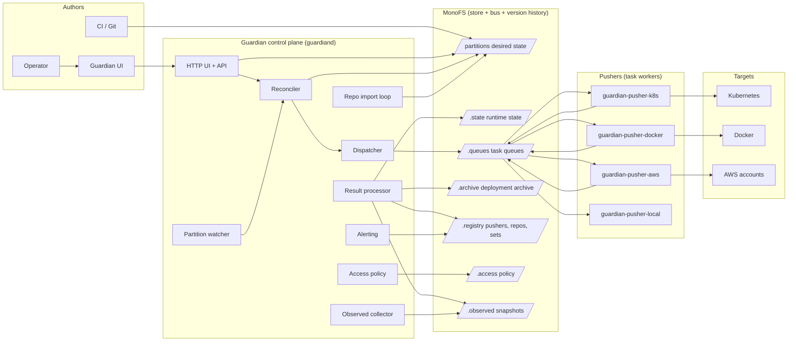
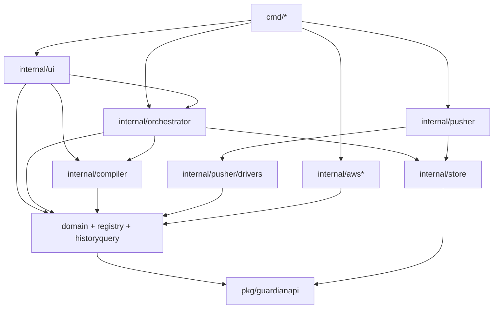
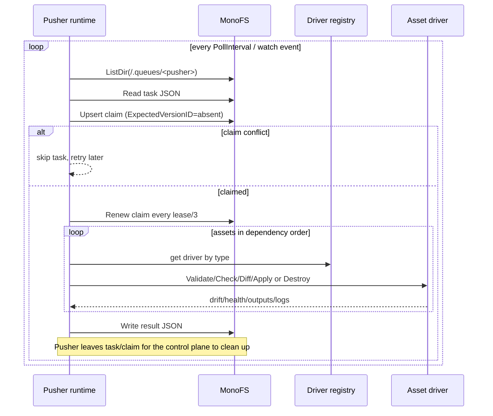

# Guardian Architecture

Status: regenerated from source, October 2026 (base commit `92ee966`).
Audience: engineers operating, extending, or reviewing Guardian.

> This document replaces the previous `docs/` set. The old documents were moved
> to [`docs_backup/`](../docs_backup/) and are kept for historical reference
> only. Everything below was derived by reading the code, not from the old docs.

Related documents:

- [Logical flows](logical-flow.md) — step-by-step request, reconcile, and deploy paths.
- [Security architecture](security-architecture.md) — trust boundaries, identity, secrets, and threat model.
- [Codebase map](codebase-map.md) — per-file description of every Go/TypeScript file.
- Internal findings: [missing pieces](internal/missing.md), [duplication](internal/duplication.md), [simplification](internal/simplification.md).

---

## 1. What Guardian is

Guardian is a declarative deployment control plane for the Strata platform. It
turns desired state stored as files in MonoFS into concrete infrastructure
operations executed by provider-specific workers ("pushers").



Guardian has **no database of its own**. MonoFS is simultaneously:

- the desired-state store (partitions, intents, payloads),
- the runtime state store (`.state`),
- the message bus (`.queues` and `.results`),
- the deployment archive (`.archive`),
- the platform registry (`.registry`),
- the access-policy distribution channel (`.access`).

Every write is versioned by MonoFS. Guardian uses those version IDs for
optimistic concurrency in the task-claim protocol and for cache invalidation,
but most control-plane state writes are currently last-writer-wins (see
[missing pieces](internal/missing.md#1-ha-and-distributed-coordination)).

### Non-goals / current boundaries

- Guardian does not own cloud credentials for tenants; the AWS pusher assumes
  per-account roles (`GuardianCdkDeployRole`) and the Kubernetes/Docker
  pushers use their own cluster/host credentials.
- Guardian is not a general-purpose workflow engine. The unit of work is one
  intent (a set of typed assets), and the supported operations are
  `DIFF`, `CHECK`, `APPLY`, and `DESTROY`.
- Guardian is not a secrets manager. Secret values live in MonoFS payloads,
  provider secret stores, or environment variables; the `Secret` asset is a
  delivery mechanism, not a vault.

---

## 2. Design principles (as implemented)

1. **Files are the API.** Desired state is a directory tree. The CLI and UI
   both write the same YAML shape; the reconciler has no private database.
2. **Level-triggered reconciliation.** A periodic full scan, a file watcher,
   and per-partition schedules all converge on `ReconcilePartition`. Missing
   events are repaired by the next scan.
3. **One intent = one task.** The compiler produces asset lists; the
   dispatcher queues one task per intent and operation. Pushers re-read the
   payloads they need.
4. **Dependency-first ordering.** Intent joins and asset `dependsOn` form DAGs
   that are topologically sorted. A dependency failure blocks dependents.
5. **Provider-specific drivers behind one contract.** Every backend implements
   `Validate`, `Check`, `Diff`, `Apply`, and `Destroy` for each asset type.
6. **Report-only observed mode.** AWS `observed` intents never queue APPLY;
   they only collect, diff, and display live CloudFormation state.
7. **No long-lived task ownership in the control plane.** A pusher claims a
   task with a CAS claim file and renews a lease; the control plane only
   inspects the queue/claim/result files.
8. **Plan for active/active, but do not assume it.** The code is written as if
   multiple replicas may run, but only repo import has a real lease. All other
   loops run on every replica.

---

## 3. Components and processes

| Binary | Source | Role | Listens | Store access |
|---|---|---|---|---|
| `guardiand` | `cmd/guardiand` | Control plane: reconciler, watcher, dispatcher, result processor, observed collector, onboarding, alerting, access policy, UI/API | UI/API (`guardian.uiListenAddress`, commonly `:8090`), `/metrics` on same server | MonoFS (writable) or in-memory |
| `guardianctl` | `cmd/guardianctl` | Operator CLI: partitions, intents, assets, repos, sets, pushers, AWS setup, images, bootstrap | none | MonoFS (direct), local FS, or discovery via guardian |
| `guardian-pusher-k8s` | `cmd/guardian-pusher-k8s` | Kubernetes task worker | none (metrics/telemetry exporter only) | MonoFS or local FS |
| `guardian-pusher-docker` | `cmd/guardian-pusher-docker` | Docker task worker | none | MonoFS or local FS |
| `guardian-pusher-aws` | `cmd/guardian-pusher-aws` | AWS task worker, account scanner, observed-state API, CloudFormation event consumer | AWS read API `:19090` by default | MonoFS or local FS; memory in `--observed-only` mode |
| `guardian-pusher-local` | `cmd/guardian-pusher-local` | In-process reference drivers for dev/dogfood | none | local FS or MonoFS |
| `guardian-docker` | `cmd/guardian-docker` | Inspect local Docker resources and diff them against desired state | none | read-only FS/MonoFS |

The daemon is a single process with multiple goroutines. There is no
sidecar/agent split inside `guardiand`; every subsystem shares the same store
client and root context.

### 3.1 `guardiand` startup

`cmd/guardiand/main.go` is the composition root:

1. Parse flags (`--config`, `--reconcile-interval`, `--ui-listen`,
   `--oidc-*`, `--authz-*`).
2. Load defaults (`internal/config`), optionally overlay YAML, then apply
   environment variables (`envconfig.go` plus a few direct overrides in
   `main.go`).
3. Configure OpenTelemetry; mirror standard logs to OTLP when enabled.
4. Open the store:
   - MonoFS when `monofs.apiEndpoint` is set;
   - in-memory otherwise (useful for tests, not for production).
5. Construct the dispatcher, compliance publisher, result processor, and
   reconciler.
6. Optionally install the control-plane deploy authorizer.
7. Start the UI/API server and the optional access-policy, repo-import, and
   unmanaged services.
8. Start the reconciler, observed collector, onboarding controller, alerting
   evaluator, partition watcher, and result processor.
9. Block until SIGINT/SIGTERM, then wait for goroutines and close the store,
   compliance publisher, and telemetry.

Important coupling: the access-policy service, repo-import loop, unmanaged
service, and client discovery are only started when the UI listen address is
non-empty. `repoImportEnabled: true` therefore has no effect on a headless
daemon. This is recorded as a finding rather than an intentional design.

---

## 4. Package architecture

```text
cmd/                           process wiring; no reusable business logic
├── guardiand                  control-plane composition root
├── guardianctl                CLI command tree
├── guardian-pusher-*          worker composition roots
└── guardian-docker            Docker inspect/diff helper

internal/
├── ui/                        HTTP API + embedded SPA + read projections
├── orchestrator/              control loop: reconciler, dispatcher, results, watcher
├── compiler/                  manifest -> validation -> resolution -> DAG -> plan
├── domain/                    canonical types: partition, intent, asset, state, task, release
├── pusher/
│   ├── runtime/               task claim/execute/result loop
│   ├── registry/              asset driver registry
│   ├── drivers/               docker, kubernetes, aws, probe, driverutil
│   ├── probes/                synthetic checks and journeys
│   └── secrets/               monofs-secret:// resolution
├── store/                     Store interface implementations: memory, fs, monofs
├── registry/                  platform records: pushers, repos, bindings
├── awsread/                   AWS observability read API (:19090)
├── awsscan/                   account scan queue + scanner
├── awsobserve/                CloudFormation event mirror + observed state
├── awsgen/                    scan result -> partition draft
├── awssetup/                  IAM roles, policies, Roles Anywhere, CDK bootstrap
├── cdkgen/                    TypeScript CDK app generation + embedded templates
├── cdktemplate/               CloudFormation template inventory/diff/relations
├── observed/                  observed-intent collection + drift
├── observedgen/               cloud assembly -> intents
├── historyquery/              release/deployment/rollout queries
├── access/                    repo-managed ACL compilation and decisions
├── authz/                     control-plane deploy authorization guard
├── alerting/, notify/         partition failure alerts and webhooks
├── compliance/                archive/state mirror to S3
├── repoimport/, repoconfig/   repo bundle import and .guardian/config.yaml
├── sets/, onboarding/, unmanaged/, onboard/
├── bootstrap/                 dev cluster bootstrap helpers
├── telemetry/, config/, paths/, buildinfo/, versioning/
└── domain/...
pkg/guardianapi/               store/API interfaces shared by commands
```

### 4.1 Dependency direction



There is no cyclic package dependency at the Go level, but the domain layer is
not pure: `internal/domain/assets` performs schema validation and imports
`internal/compiler/validator` types indirectly through its registry. The
`internal/domain/asset` (singular) and `internal/domain/assets` (plural)
packages are related but distinct: singular holds the wire types, plural holds
typed specs, validation, and the UI catalog.

---

## 5. Domain model

### 5.1 Partition

A partition is the ownership and reconciliation unit. It is a YAML document
(`guardian/v1alpha1`, `kind: Partition`) at
`/partitions/<name>/config.yaml`.

| Field | Meaning |
|---|---|
| `metadata.name` | Partition name; must match the directory and name regex `^[a-z][a-z0-9-]*$` |
| `spec.deletionPolicy` | `orphan` (keep resources, delete Guardian state) or `destroy` (run DESTROY for every intent before purge) |
| `spec.reconciliation.mode` | `auto`, `manual`, or `readonly` |
| `spec.reconciliation.interval` | Go duration or 5-field cron expression |
| `spec.reconciliation.jitterPercent` | Deterministic phase offset for interval schedules |
| `spec.defaults` | Default pusher/target, observability injection, probe defaults |
| `spec.labels` / `metadata.labels` | Selection labels used by access policy and UI |
| `spec.sets` / `spec.primarySet` | Virtual navigation membership |

Validation is in `internal/compiler/validator/validator.go`. Notably,
`defaults.targetPusher`, `defaults.target`, `sets`, and jitter are not fully
validated at compile time.

### 5.2 Intent

An intent is one deployable unit, stored at
`/partitions/<name>/intents/<intent>.yaml`.

| Field | Meaning |
|---|---|
| `spec.intentType` | `standard` (DIFF → CHECK → APPLY) or `observed` (report-only AWS) |
| `spec.implementation` | `native` (provider SDK drivers, default) or `cdk` (AWS: compile supported assets into one generated CloudFormation stack) |
| `spec.joins` | Other intents that must be healthy first |
| `spec.targetPusher` | Queue name / pusher that must execute the intent |
| `spec.target` | Placement: cluster, namespace, region, account |
| `spec.locked` | Prevents destructive/rollout actions (enforced partially; see security doc) |
| `spec.assets` | Ordered list of asset specs |

### 5.3 Asset

An asset is the smallest typed unit of infrastructure:

```yaml
type: Compute
name: api
version: v1.2.3            # optional pin
dependsOn: [db]
payload:
  kubernetes: payloads/kubernetes/api.yaml
  aws: payloads/aws/api.yaml
properties: {...}           # typed per asset; validated against catalog
skip: false
flowMetricGroups: [checkout]
hints: [...]
```

The canonical asset types are declared in
`internal/domain/asset/catalog.go`:

| Type | Purpose | Primary drivers |
|---|---|---|
| `Compute` | Long-lived service/worker/daemon | Docker, Kubernetes, AWS ECS, local |
| `ImageBuild` | Build/publish an OCI image | Kubernetes BuildKit; Docker/registry existence checks; `guardianctl image` pipeline |
| `CDKStack` | Bring-your-own TypeScript CDK app | AWS |
| `Database` | Database (legacy alias for SQLDatabase) | all pushers that support SQLDatabase |
| `SQLDatabase` | Managed SQL database | Docker, Kubernetes, AWS (Aurora) |
| `Volume` | Persistent volume | Docker, Kubernetes, AWS (EFS) |
| `Config` | Non-secret configuration file(s) | all |
| `Network` | Network boundary | Kubernetes, AWS |
| `Secret` | Secret value delivery | all |
| `LoadBalancer` | L4/L7 load balancer | Kubernetes, AWS |
| `TraefikRoute` | Routing metadata | Docker, Kubernetes |
| `ObjectStore` | Object bucket | Docker/MinIO, AWS S3 |
| `Observability` | Telemetry sidecar/agent/config | Docker, Kubernetes, AWS, local |
| `Probe` | HTTP/TCP/DNS/TLS/gRPC check or journey | all pushers |
| `K8sResource` | Raw Kubernetes manifest | Kubernetes only |
| `AWSResource` (internal) | Fallback raw CloudFormation resource | AWS |
| `GeneratedStack` (internal) | Synthetic asset carrying a generated CDK stack | AWS |

The **UI catalog** (`internal/domain/assets/catalog.go`) supplies default
templates, editable fields, and hints for the visual builder. The **typed
specs** (`compute.go`, `network.go`, …) are the validation/serialization
authority. The two are maintained separately, which is a source of drift
(see [duplication](internal/duplication.md)).

### 5.4 Runtime state

`PartitionState` and `IntentState` are JSON documents under
`/partitions/<p>/.state/`. `IntentStatus` has 17 values:

```text
Invalid, Blocked, Ready, Checking, CheckFailed, Diffing, DiffFailed,
Drifted, DriftedLocked, Observed, ObservedDrifted, Applying, Healthy,
ApplyFailed, Destroying, Destroyed, Orphaned
```

A successful APPLY promotes the intent to `Healthy` and records a deployment
revision. Observed intents use `Observed` / `ObservedDrifted` and never APPLY.
`readonly` is represented by `DriftedLocked`, not by a separate field.

### 5.5 Task and result

Tasks are JSON documents at `/.queues/<pusher>/<taskID>.json`:

```json
{
  "taskID": "...",
  "op": "DIFF|CHECK|APPLY|DESTROY",
  "partition": "...",
  "intent": "...",
  "targetPusher": "...",
  "partitionRevision": "...",
  "intentSpecHash": "...",
  "assetVersionIDs": {"asset": "version"},
  "assets": [{"type": "...", "name": "...", "dependsOn": [...], "payload": {...}, "properties": {...}}],
  "forceApply": false,
  "createdAt": "..."
}
```

Pushers claim via `/.claims/<taskID>.json` (CAS on creation, lease renewal) and
write `/\<pusher\>/.results/<taskID>.json` with outputs, drift, health,
apply-readiness, asset observations, errors, and logs.

### 5.6 Release, deployment, history, archive

- **ReleaseRecord** — the latest successful apply per intent, stored in
  `/partitions/<p>/.state/releases.json` (authoritative pointer).
- **DeploymentRecord** — historical deployment view, derived from the archive.
- **Archive** — `/ .archive/<p>/<intent>/<revision>/{manifest.yaml,state.json,logs.ndjson}`.
- **Events** — `.state/events/<id>.json`, pruned to 250 per partition.

There are two overlapping history representations (`ReleaseRecord` and
`DeploymentRecord`) and two overlapping source paths (release log fast path and
archive scan). This is documented in [duplication](internal/duplication.md).

---

## 6. Store namespace

All paths are logical Guardian paths; the MonoFS adapter maps them to physical
MonoFS paths (`guardian/` and `guardian-system/`). See
`internal/paths/paths.go` and `internal/store/monofs/adapter.go`.

| Logical path | Written by | Purpose |
|---|---|---|
| `/partitions/<p>/config.yaml` | CLI, UI, repo import | Partition desired state |
| `/partitions/<p>/intents/<i>.yaml` | CLI, UI, repo import | Intent manifests |
| `/partitions/<p>/payloads/**` | CLI, UI, repo import | Provider payloads, source trees, generated CDK |
| `/partitions/<p>/payloads/aws-generated/<i>/**` | Reconciler | Generated TypeScript CDK app |
| `/partitions/<p>/.state/partition.json` | Dispatcher | Compiled partition state |
| `/partitions/<p>/.state/intents/<i>.json` | Dispatcher | Per-intent runtime state |
| `/partitions/<p>/.state/assets/<i>--<a>.json` | (unused helper) | Per-asset state path exists in `paths` but is not written in production |
| `/partitions/<p>/.state/events/<id>.json` | Dispatcher | Event timeline |
| `/partitions/<p>/.state/releases.json` | Dispatcher | Latest release pointer per intent |
| `/partitions/<p>/.state/tasks/<task>.json` | Dispatcher | Immutable audit copy of every queued task |
| `/partitions/<p>/.state/repo-import.json` | Repo importer | Ownership manifest used for safe pruning |
| `/partitions/<p>/.deletion.json` | CLI/UI | Deferred deletion marker |
| `/partitions/<p>/.observed/<i>/*.json` | Observed collector | Snapshots and observed events |
| `/.queues/<pusher>/<task>.json` | Dispatcher | Task queue |
| `/.queues/<pusher>/.claims/<task>.json` | Pusher | CAS claim + lease |
| `/.queues/<pusher>/.results/<task>.json` | Pusher | Task result |
| `/.archive/<p>/<i>/<rev>/*` | Dispatcher | Deployment archive |
| `/.registry/pushers/<name>.json` | CLI/UI/pusher heartbeat | Pusher registration, token |
| `/.registry/repos/<name>.json` | CLI/UI | Repo registration and bindings |
| `/.registry/onboarding/<pusher>/<stack>.json` | Onboard controller | Last onboarding descriptor |
| `/.registry/dashboards/<p>.json` | Dashboard generator | Grafana dashboard |
| `/.registry/probes/<pusher>/<p>.json` | Probe runner | Latest probe snapshot |
| `/.registry/sets/<id>.json` | CLI/UI | Virtual sets |
| `/.registry/set-primary/<p>.json` | CLI/UI | Primary set pointer |
| `/.scans/<pusher>/requests/<id>.json` | CLI/UI | AWS scan request |
| `/.scans/<pusher>/.claims/<id>.json` | Scan runner | Scan lease |
| `/.scans/<pusher>/.results/<id>.json` | Scan runner | Scan result |
| `/.access/envs/<env>.yaml` | CI/CLI | Raw ACL |
| `/.access/compiled/policy.json` | `guardianctl access publish` | Compiled policy bundle served to MonoFS/Doctor |
| `/.templates/aws/**` | Operator | CDK template overlays |
| `/.repos/<display-path>/**` | Repo publisher | Read-only repo mirror |

The MonoFS adapter rejects unknown top-level namespaces. `normalize` uses
`path.Join` + `path.Clean`, so `..` is collapsed rather than rejected; callers
that accept user-supplied names must validate them before constructing paths
(see the security document).

---

## 7. Control plane

### 7.1 Reconciler

`internal/orchestrator/reconciler` is the heart of the system.

- `Run` validates the interval, starts a quartz scheduler and a priority
  worker pool, performs a synchronous full reconcile, then registers a
  discovery job every 30 seconds.
- `ReconcilePartition` reads config and intents, compiles them, writes a
  compiled partition state, handles removed intents, generates CDK payloads,
  and iterates intents in dependency order.
- `ReconcileAll` fans out over all owned partitions on startup and after
  watcher reconnects.
- `ForceApplyPartition` bypasses the normal DIFF/CHECK path and queues APPLY.

Scheduling:

- Per-partition interval or cron from `spec.reconciliation`.
- A fixed 30s discovery job re-syncs quartz jobs when partitions appear or
  change.
- Priority pool: Critical for Applying/Destroying, High for drifted/failed,
  Normal otherwise; aging prevents starvation.
- Optional sharding by partition name hash (`shardIndex`/`shardCount`).

Deletion:

- A marker at `.deletion.json` triggers `reconcilePartitionDeletion`.
- `destroy` policy: observed intents are removed; already-destroyed intents are
  skipped; everything else gets a DESTROY task built from the archived or live
  manifest. Purge happens only when no intent is `Destroying`.
- `orphan` policy: delete all intent state and purge the partition subtree.
- Purge also scans all pusher queues and deletes tasks/claims/results for the
  partition (best effort; errors are swallowed).

### 7.2 Watcher

`internal/orchestrator/watcher` subscribes to `/partitions` (or a specific
partition), debounces per partition (`guardian.debounceMs`, default 250 ms;
the watcher falls back to 100 ms when passed zero), and emits only
`config.yaml` and `intents/*.yaml` changes. It deliberately ignores
`.deletion.json`, so deletion pickup relies on an explicit reconcile or the
partition's next scheduled reconcile. Manual-mode partitions have no schedule,
so they require an explicit reconcile. On stream closure the daemon reconnects
and runs a full reconcile first.

### 7.3 Dispatcher

`internal/orchestrator/dispatcher` is the principal writer of compiled/runtime
intent state, release records, archives, events, and task queue files. (The
observed collector owns `.observed` and observed intent state, the probe runner
owns `/.registry/probes`, and alerting owns `notifications.json`.) It provides:

- `QueueTask` (queue file plus immutable `.state/tasks` audit copy),
  `WriteIntentState`, `WritePartitionState`, `DeleteIntentState`,
  `WriteEvent`, `ArchiveDeployment`, `WriteRelease`.
- Per-partition write mutex and a process-local content hash that suppresses
  byte-identical writes.
- Cached partition runtime, release log, event history, and generated-payload
  fingerprints.
- Compliance mirroring hooks for state/archive writes.
- Prometheus metrics for writes, bytes, skipped writes, deletes, and status
  gauges.

`WriteRelease` is a read-modify-write of the whole release map under a local
mutex but without `ExpectedVersionID`, so multiple replicas can lose entries.

### 7.4 Result processor

`internal/orchestrator/results.Processor` consumes `TaskResult` documents:

- Validates that the result's task ID matches the intent's `LastTaskID`
  (unless the state has an empty task ID).
- Switches on the result operation:
  - `CHECK`: record readiness/health; on success optionally queue APPLY.
  - `DIFF`: record drift; if changed, queue APPLY (unless read-only/locked).
  - `APPLY`: promote to Healthy, record outputs, archive, release, queue
    dependents.
  - `DESTROY`: mark Destroyed or Orphaned.
- On failure: record the error, roll status back (`ApplyFailed`,
  `CheckFailed`, `DiffFailed`), and preserve enough information for retry.
- Cleans up the queue task, claim, and result files.

The processor trusts the pusher's result: it does not verify the operation,
partition, intent, or target against the queued task. This is a security and
integrity gap (see security doc).

### 7.5 Observed collector

`internal/observed` periodically polls each pusher's observed read API:

- Resolves pusher endpoints from static config plus `/.registry/pushers`.
- Refreshes each observed stack, optionally runs CloudFormation drift
  detection.
- Computes a diff against desired state (prebuilt template or uploaded source).
- Writes `IntentState`, per-asset snapshots, and 24h observed event files.
- Never queues APPLY for observed intents.

### 7.6 Alerting

`internal/alerting` polls partition runtimes, classifies failures by event and
severity, applies fail threshold/cooldown/repeat rules, and sends JSON webhooks
with an HMAC-SHA256 signature. State is persisted in `notifications.json` per
partition. Delivery is at-most-once per evaluation with limited retry; partial
channel success suppresses retry until the repeat interval.

### 7.7 Onboarding and unmanaged adoption

- `internal/onboarding` reads customer descriptors from SSM (via the AWS
  pusher read API) and validates them.
- `internal/onboard` materializes observed partitions and intents from those
  descriptors on an interval.
- `internal/unmanaged` discovers CloudFormation stacks that are not yet
  managed by Guardian, classifies them against repo bindings, and can open a
  MonoFS review branch with an adoption proposal.

### 7.8 Access policy

`internal/access` compiles a repo-managed ACL (`access.yaml`) against the live
partition catalog at `/.access`, producing a policy bundle served to MonoFS and
Doctor. It supports three modes: disabled (permissive), observe (log denials,
do not enforce), and enforce (filter reads, fail closed for non-admins when no
policy is loaded). The UI currently applies it to partition GETs only; mutation
authorization is not wired.

---

## 8. Compiler

`internal/compiler` converts raw YAML into a deterministic plan.

```mermaid
flowchart LR
    A[config.yaml + intents/*.yaml] --> B[manifest.Parse*]
    B --> C[validator.ValidatePartition/Intent]
    C --> D[asset validators + DAG]
    D --> E[resolver.ResolveProperties]
    E --> F[planner.Compile]
    F --> G[CompiledPartition]
    G --> H[dispatcher task]
    H --> I[pusher]
```



1. **Parse** (`manifest/parser.go`) with strict `apiVersion`/`kind` checks; only
   the first YAML document is read; unknown fields are not rejected.
2. **Validate partition** — name, deletion policy, mode, interval/cron,
   observability enums, probe ranges.
3. **Validate each intent** — intent type, implementation, joins, target
   pusher, duplicate asset names, type-specific property validators, payload
   path existence/absolute-path rules, dependency cycle checks.
4. **Inject defaults** — a synthetic `Observability` asset for eligible
   Compute assets when partition defaults enable observability.
5. **Resolve outputs** — `${asset.outputs.key}` / `${intent.asset.outputs.key}`
   references are resolved from current state where possible; unresolved
   references are deferred.
6. **Hash/version** — per-asset version IDs, intent spec hash, partition
   revision (`configVersionID + intent version IDs`).
7. **Topologically sort** assets and intents; produce `CompiledPartition`.
8. **Build task** — the dispatcher re-parses the raw manifest via
   `BuildTaskFromManifest`, re-resolves, removes skipped assets in two passes,
   substitutes `GeneratedStack` for CDK intents, and writes one task.

The compile is all-or-nothing per partition: one invalid intent marks the whole
partition invalid. CDK generation failures, dependency failures, and task-build
failures block only the affected intent.

---

## 9. Pusher runtime and drivers

### 9.1 Runtime loop



Details:

- Poll interval default 5s; optional watch on the queue path.
- Claim lease 300s, renewed every 100s. If renewal fails, execution continues
  but another worker may take over after expiry.
- `CanHandle` filters tasks by account/region (AWS) or target (K8s).
- Sharding by task-ID hash (`shardIndex`/`shardCount`); Docker pusher does not
  expose sharding.
- Secret asset `value` outputs are redacted before the result is written;
  `valueHash` remains for drift detection, and known secret values are scrubbed
  from logs/errors. The result processor redacts again as defense in depth.
- Result is written once, no retry, no CAS. If the write is lost, the task
  remains in-flight until the reconciler's stale timeout, then a new task is
  queued. The control-plane safety scan recovers results that exist but were
  not delivered by the watcher; it cannot recover a result that was never
  written.

### 9.2 Driver registry

`internal/pusher/registry` maps asset type -> `AssetDriver`:

```go
type AssetDriver interface {
    Type() string
    Validate(ctx, task, asset) error
    Check(ctx, task, asset) (CheckResult, error)
    Diff(ctx, task, asset) (DriftReport, error)
    Apply(ctx, task, asset) (ApplyResult, error)
    Destroy(ctx, task, asset) error
}
```

Optional interfaces add observed state (`ObservedStateDriver`) and context
validation (`ContextValidator`).

### 9.3 Backends

| Driver family | Desired-state mechanism | Apply mechanism |
|---|---|---|
| Docker | Owner labels, container/network/volume names, payload files | Docker CLI (or API backend) |
| Kubernetes | Labels/annotations (`guardian.*`), manifests | client-go server-side apply (`Force: true`) or kubectl |
| AWS native | Per-asset specs and tags | AWS SDK (CloudFormation for some, service APIs for others) |
| AWS CDK/GeneratedStack | Generated TypeScript app + CFN stack | `cdk deploy` CLI |
| Local | In-memory maps | No real infrastructure |

The AWS pusher combines a **CLI backend** (CDK/CloudFormation) and an **SDK
backend** (resource CRUD/IAM) in a composite. The split is by method, not by
asset: some operations go to CDK, others to the SDK.

### 9.4 Probes

`internal/pusher/probes` runs independently of task execution. It discovers
targets from manifests/state or onboarding descriptors and executes HTTP, TCP,
DNS, TLS, gRPC, and multi-step journeys. Results are written as a latest
snapshot per partition and exported through OTLP/HTTP. There is no probe result
history in MonoFS.

---

## 10. AWS subsystem

The AWS integration is the largest provider-specific area.

| Package | Responsibility |
|---|---|
| `awssetup` | Create `GuardianCdkDeployRole`, scoped deploy policy, IAM Roles Anywhere trust anchor/profile, CDK bootstrap, ECR repos |
| `awsgen` | Convert scan results into partition/intent drafts |
| `awsscan` | Request/claim/run account scans (S3, EFS, SSM, Secrets, ECS, ELBv2, CloudFormation, best-effort CloudControl) |
| `awsread` | HTTP read API: CloudWatch metrics/alarms, Logs Insights, X-Ray, PromQL proxy, observed stacks, onboarding, probes |
| `awsobserve` | EventBridge→SQS consumer, in-memory observed cache, live refresh, template diff, source upload/synth |
| `observed` | Guardian-side collector and drift comparer |
| `observedgen` | Cloud assembly → observed/managed intents |
| `cdkgen` | Asset catalog → TypeScript CDK app, overlays, payload manifest, IAM actions |
| `cdktemplate` | Template inventory, comparison, semantic relations |
| `internal/pusher/drivers/aws` | Native and CDK drivers, backend abstraction, naming, execution roles |

### 10.1 AWS read API

The pusher serves `127.0.0.1:19090` by default (loopback; override with
`--awsread-addr` or `GUARDIAN_AWSREAD_ADDR`). Routes include:

```text
GET /healthz
GET /v1/aws/meta
GET /v1/aws/alarms
GET /v1/aws/alarms/history
GET /v1/aws/metrics
POST/GET /v1/aws/metrics/query
GET /v1/aws/log-groups
POST /v1/aws/logs/query
GET /v1/aws/xray/services
POST /v1/aws/xray/traces
GET /v1/aws/xray/trace/{id}
GET/POST /v1/aws/promql/{query,query_range,series,labels,label/<name>/values}
GET /v1/aws/onboarding
GET /v1/aws/probes
GET /v1/aws/observed/stacks
GET /v1/aws/observed/stacks/{name}
GET /v1/aws/observed/events
POST /v1/aws/observed/refresh
POST /v1/aws/observed/diff
```

Authentication is a single static bearer token; an empty token disables auth.
There is no TLS, scoping, rate limiting, or pagination. This is a significant
security exposure; see [security architecture](security-architecture.md).

### 10.2 CDK generation

For `implementation: cdk`, the reconciler generates a deterministic TypeScript
app per intent:

- Catalog templates live under `internal/cdkgen/embed/templates/aws/v1/`
  (`compute.fargate`, `database.aurora-*`, `loadbalancer.alb/nlb`,
  `network.default/vpc`, `objectstore.s3`, `volume.efs`,
  `observability.otel-sidecar`, `fallback.cfn-resource`, `_shared`).
- Overlays come from the store (partition > global > embedded).
- `catalog.yaml` defines which asset types are CDK-expressible and their
  required IAM actions.
- The generator writes `lib/stack.ts`, `guardian.payload.json`, and support
  files under `/partitions/<p>/payloads/aws-generated/<intent>/`.
- The dispatcher substitutes a synthetic `GeneratedStack` asset. The pusher
  stages the tree, hashes it, optionally creates a per-intent CloudFormation
  execution role, and runs `cdk synth` / `cdk deploy`.
- Assets that are not CDK-expressible (Secret, Config, etc.) keep using their
  native drivers.

### 10.3 Observed mode

AWS `observed` intents are populated by:

1. `awsscan` producing inventory (optional).
2. `observedgen` producing intents from a CDK cloud assembly.
3. `awsobserve` maintaining a live cache from SQS/CloudFormation.
4. `internal/observed` polling the read API, diffing, and writing state.

Observed intents are report-only: the reconciler writes metadata and skips
queueing; only the collector writes their derived state.

---

## 11. UI and API

`internal/ui` is both the web application and the principal management API.
It embeds a vanilla TypeScript SPA (no framework) compiled to
`static/app.js`/`app.css`.

### 11.1 API surface (summary)

| Area | Endpoints |
|---|---|
| Meta | `/`, `/health`, `/metrics`, `/api/v1/status/buildinfo`, `/api/catalog`, `/api/me`, `/api/overview` |
| Client/access | `/api/client-config`, `/api/access/policy`, `/api/access/explain` |
| Partitions | `GET/PUT/DELETE /api/partitions/{name}`, `/topology`, `/rollouts`, `/history`, `/validate`, `/reconcile`, `/intents/{i}/activity` |
| Scans | `/api/scans`, `/api/scans/{id}`, `/api/scans/{id}/bundle` |
| Pushers | `/api/pushers`, `/api/pushers/{name}`, `/summary`, `/api/m2m/pushers*` |
| Repos | `/api/repos`, `/api/repos/{name}`, `/ingest`, `/bindings`, `/notify` |
| Sets | `/api/sets`, `/api/sets/{id}`, `/move`, `/partitions` |
| Probes/obs | `/api/probes`, `/api/probes/{id}`, `/api/observability/identities` |
| Unmanaged | `/api/aws/unmanaged`, `/associate` |
| Federation | `/api/m2m/federation/partitions` |
| M2M aliases | `/api/m2m/overview`, `/api/m2m/partitions*` |

The daemon wraps the mux with OIDC bearer verification (observe mode by
default) and optional browser login. In addition, every mutating request passes
through `Server.authorizeMutation`: partition mutations require
`access.CanModify` on the target, registry/repo/set/scan mutations require
`access.IsAdmin`, and the check is a no-op only when the access policy is
disabled. Reads use access-policy filtering. Anonymous deployments are still
possible when neither login nor an access policy is configured.

### 11.2 Frontend

- `main.ts` — entry point, routing via query string, polling, overview/detail/
  history/rollout/topology rendering.
- `builder.ts` — visual partition/intent/asset editor with drag/drop,
  connectors, inspector, validation, drafts, templates, undo/redo.
- `sets.ts`, `scan.ts`, `registry.ts`, `unmanaged.ts`, `topology.ts`,
  `state.ts`, `utils.ts` — feature modules.
- Rendering is string templates + `innerHTML` with manual escaping; there is no
  CSP and no CSRF token.

### 11.3 Server-side projections

`internal/ui/data.go` is the read model: it loads partition detail, compiles
manifests, derives health/status, builds topology and rollout views, and
redacts output values. It is a large, central file (roughly 3k lines) and is
the main scalability hotspot on the UI side.

---

## 12. CLI (`guardianctl`)

The CLI is a hand-rolled command registry over the standard `flag` package.
Root flags must precede the command group.

Connection modes:

1. **Guardian discovery** — `GUARDIAN_API_URL`/`GUARDIAN_URL` points at the
   Guardian UI; `GET /api/client-config` returns the MonoFS router/token. A
   non-loopback endpoint requires `GUARDIAN_CLIENT_DISCOVERY_TOKEN`.
2. **Direct MonoFS** — `GUARDIAN_MONOFS_ROUTER` + `GUARDIAN_MONOFS_TOKEN`.
3. **Local store directory** — `GUARDIAN_STORE_DIR`, no auth.

Command groups: `auth`, `partition`, `intent`, `asset`, `store`, `filesystem`,
`aws`, `sets`, `pusher`, `probe`, `observability`, `repo`, `template`,
`access`, `notify`, `dev`, `image`, `release`.

The CLI writes directly to MonoFS as principal `guardianctl`; it does not go
through the daemon. This means it bypasses the UI access policy. See the
security document.

---

## 13. GitOps, bootstrap, and packaging

### 13.1 Repo-driven partitions

Repositories declare a deployment surface in `.guardian/config.yaml`. The
supported sources are:

- `git` — clone/fetch a URL and read `guardian/partitions/**`;
- `monofs` — read a logical path directly (repo mirror under `/.repos`);
- `native` — no repository; authored directly in the store.

`guardianctl repo add/seed/sync/apply/ingest/notify` registers and imports
repos. `guardiand` also runs a sharded, optionally leased repo-import loop.
Import maps:

```text
guardian/partitions/<p>/partition.yaml|config.yaml -> /partitions/<p>/config.yaml
guardian/partitions/<p>/intents/*.yaml              -> /partitions/<p>/intents/
guardian/partitions/<p>/payloads/**                 -> /partitions/<p>/payloads/
```

Import writes an ownership manifest at
`/partitions/<p>/.state/repo-import.json`. Pruning removes files recorded by
the same source and no longer present in the repo; files owned by another
source are preserved. Removing an entire partition still requires an explicit
delete. `secrets/**` is ignored and inline `Secret.value` is rejected.

### 13.2 Bootstrap

`guardianctl dev *` commands render templates from an external
`stratatools/deploy/bootstrap` tree, apply them with `kubectl`, build sibling
repo images, create a kind cluster/registry, and deploy MonoFS, lb-edge,
Guardian, and a host Docker pusher. This tooling is development-only and
currently references files outside this repository (see
[missing pieces](internal/missing.md#11-build-release-and-packaging)).

### 13.3 Packaging

- `Dockerfile` builds `guardiand` and the entrypoint writes a temporary config.
- `Dockerfile.pusher-{aws,docker,k8s}` build each pusher.
- `Makefile` has build/test/dogfood targets; several lifecycle targets are
  declared but empty (documented in findings).
- Images run as root and mount the Docker socket for the Docker pusher.

---

## 14. Observability

- All processes can export OTLP traces, metrics, and logs when
  `OTEL_EXPORTER_OTLP_ENDPOINT` (or equivalent) is set.
- `internal/telemetry` builds resource attributes (service, version, VCS
  revision, branch, build date) and mirrors `log` output to OTLP.
- `guardiand` exposes Prometheus metrics on the UI server at `/metrics`.
- Runtime metrics include partition/intent status gauges, queue/task counters,
  asset health/readiness observations, and dispatcher write counters.
- Probe results are exported as OTLP metrics/logs/traces and stored as latest
  snapshots in `/.registry/probes/`.
- AWS read API provides CloudWatch/X-Ray/PromQL access to Doctor.

---

## 15. Deployment topology

A typical installation:

```text
kind / Kubernetes cluster
├── monofs namespace            MonoFS routers + storage
├── lb-edge namespace           edge ingress / load balancer
└── guardian namespace
    ├── guardian (Deployment)   guardiand + UI service :8090
    ├── pusher-k8s (Deployment)
    ├── pusher-aws (Deployment) AWS read API :19090
    └── pusher-docker (host)    Docker socket + state dir

AWS account(s)
├── GuardianCdkDeployRole       assumed by the AWS pusher
├── CDKToolkit stack            cdk bootstrap
├── Guardian-managed stacks     partitioned by intent
└── CloudWatch/X-Ray            read by Doctor via the pusher
```

The bootstrap path also creates a local registry (`registry.strata.local:5000`)
and a host Docker pusher with `--network host` and the Docker socket. Treat that
as a development topology, not a hardened production baseline.

---

## 16. Extension points

### Add an asset type

1. Add the constant in `internal/domain/asset/catalog.go`.
2. Add a typed spec + `Decode`/`Validate` in `internal/domain/assets/`.
3. Register the validator in `internal/domain/assets/registry.go`.
4. Add catalog metadata/fields in `internal/domain/assets/catalog.go`.
5. Implement `AssetDriver` in each pusher that should support it.
6. Register the driver in the pusher's `drivers.go`.
7. If AWS CDK-expressible, add a template under
   `internal/cdkgen/embed/templates/aws/v1/<type>/` and a catalog entry.
8. Add tests for validation, task building, and driver behavior.

### Add a pusher/backend

1. Implement `AssetDriver` for the relevant asset types.
2. Build a `registry.Registry` and a `runtime.Runtime`.
3. Register with MonoFS (`StartRegistration`) and resolve its queue path.
4. Add the pusher name to `GUARDIAN_PUSHERS`/config so the control plane watches
   its results.
5. Document target placement and ownership labels.

### Add a control-plane loop

Use the `run(name, fn)` pattern in `cmd/guardiand/main.go`, accept the root
context, and make the loop idempotent and restart-safe. Do not assume single
replica unless you add a lease.

---

## 17. Architectural invariants and known deviations

Invariants the code intends to preserve:

1. Desired state is the only source of truth; runtime state is derived and
   rebuildable from the store + archive.
2. Tasks are immutable once queued; pushers re-read payloads.
3. Asset operations are idempotent and ordered by dependency.
4. Observed intents never mutate infrastructure.
5. Every state change is attributable to a principal and correlation ID.
6. Deletion is deferred and explicit.

Known deviations (details in the internal docs):

- No leader election for core loops; state writes lack CAS.
- Compiled plans are not the execution source of truth; tasks re-parse raw
  YAML.
- Access policy now guards UI mutations, but CLI/pusher tokens bypass it and
  anonymous deployments are still possible without a login wall.
- Secret values are redacted from results/state/UI, but queue files still carry
  them in flight and the model is not reference-only.
- Some AWS drivers do not create working resources (Aurora without instances,
  EFS without mount targets, Network without subnets).
- The AWS read API now defaults to loopback but is still plaintext HTTP.
- Build/release packaging is incomplete.

These are not small implementation details; they define the current security
and reliability posture. The [security architecture](security-architecture.md)
and [internal findings](internal/missing.md) treat them as first-class work
items.

### Recent P0+P1 mitigations

- Result provenance is checked against the queued task.
- Path/name traversal is rejected at result, UI, CLI, and repo-import
  boundaries.
- UI mutations are authorized through the access policy (`CanModify`/`IsAdmin`).
- Secret values are redacted from results/state/UI and replaced with a
  `valueHash` for drift detection.
- The AWS read API defaults to loopback.
- DESTROY tasks recover from stale/lost results.
- Task specs are archived under `.state/tasks`.
- Repo import prunes owned files via an ownership manifest.
- The daemon, UI, and CLI share one importer and one image pipeline.

See [Changes applied](internal/changes.md) for file/test references and the
remaining work.
