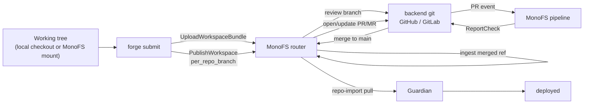
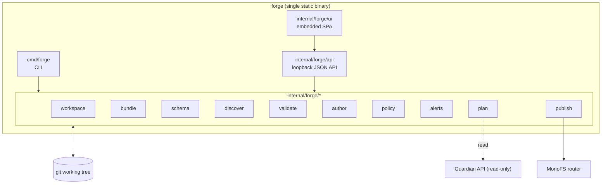

# Forge — repository workbench for Guardian partitions

Status: proposed
Audience: engineers building or operating the partition authoring workflow
Scope: repository-first authoring of Guardian partitions; CLI and local UI

Related documents:

- [Architecture](../architecture.md) — Guardian control plane, bundles, reconcile.
- [Logical flows](../logical-flow.md) — reconcile and deploy paths.
- [Security architecture](../security-architecture.md) — trust boundaries.

---

## 1. Summary

Forge prepares a repository so Guardian has nothing left to guess. It is one
Go binary with two front ends — a CLI and an embedded local web UI — that helps
a user discover workloads, author partition manifests and assets, define
policies, write alert rules, validate everything offline, and submit the change
as a real pull/merge request.

Forge never mutates Guardian or MonoFS state. Its only publish action is a
**proposal**: it hands a bundle to MonoFS, MonoFS pushes a review branch and
opens a real PR/MR, required checks run, a human merges, MonoFS re-ingests the
merged ref, and Guardian pulls the result. Direct modification outside that
path is denied.

### The invariant

> **No change reaches Guardian except through: git branch → backend PR/MR →
> required checks → merge → MonoFS ingest → Guardian repo-import pull →
> reconcile.**



---

## 2. Problem

Guardian already has the runtime control plane and the state model. What is
missing is the **authoring** layer:

| Need | Today |
| --- | --- |
| Create a partition tree in a repo | Hand-write YAML; `guardianctl partition init` only writes the config into the live store |
| Know asset property shapes | Read `internal/domain/assets/catalog.go` or copy an existing partition |
| Catch mistakes before merge | `guardianctl partition validate-local` parses YAML and performs limited semantics |
| Preview what a change will do | Only after it is in the store |
| Author policies and alerts | Hand-write; access policy has `lint`/`compile` but no authoring |
| Avoid bypassing CI/CD | Possible today via direct store writes and the Guardian UI save path |

The existing Guardian UI is a **runtime control center**: it edits the live
MonoFS store (`/api/partitions/{name}/bundle` → `saveBundle`). It cannot help
prepare a repository, and using it for production changes bypasses review.

Forge is therefore complementary, not a second control center:

- Guardian UI — runtime visibility and emergency operations.
- Forge — offline authoring, verification, and reviewed proposals.

### Non-goals

- Forge is not a deployment engine. It never calls a pusher.
- Forge is not a second source of truth. Files in the repository are the
  source; `.forge/` holds regenerable local state only.
- Forge does not implement git, GitHub, or GitLab clients. MonoFS does.
- Forge does not replace `guardianctl`; it delegates and reuses.

---

## 3. Locked decisions

| Decision | Choice | Rationale |
| --- | --- | --- |
| Language | Go 1.26 | Reuses Guardian's domain types, validator, asset catalog, and MonoFS client. Single static binary, cross-compiles with `CGO_ENABLED=0`. |
| Code location | `guardian/cmd/forge` + `guardian/internal/forge/*` | Direct access to `internal/` packages; ships as a separate binary. |
| UI delivery | Embedded SPA served by `forge` on loopback, opened in the browser | No WebKit/WebView2 dependency. Identical behaviour on Linux and Windows. |
| UI stack | Vue 3 + Vite + Tailwind 4, `design/tokens.css` for visuals | Matches the platform's other SPA (MonoFS UI) and suits form-heavy editing. |
| Publish | MonoFS workspace publish | MonoFS already pushes review branches and opens PRs/MRs. |
| Approval | Real PR/MR at the forge | One sign-off sheet. Native `/api/merge-requests` is only for forge-less workspaces. |
| CI | MonoFS pipeline engine | Runs on the PR head; reports a check back to the forge so merge is blocked. |
| v1 assets | Kubernetes + Docker | Full validation coverage before adding AWS/GCP. |
| First user | Platform team, dogfooding `stratatools/partitions` | Real fixtures, immediate value. |

---

## 4. What already exists

Nothing below needs to be invented; Forge composes it.

| Capability | Location |
| --- | --- |
| Partition / intent / asset types | `internal/domain/partition`, `internal/domain/intent`, `internal/domain/asset` |
| Asset catalog (template + fields + hints) | `internal/domain/assets/catalog.go` (`Catalog()`, `CatalogTemplate`, `CatalogField`) |
| Typed per-asset validation | `internal/domain/assets/registry.go` (`Definitions.Validate`) |
| Partition/intent validation | `internal/compiler/validator/validator.go` |
| Planner and DAG | `internal/compiler/planner`, `internal/compiler/dag` |
| Local bundle loading | `cmd/guardianctl/partition_push.go` (`loadLocalPartitionBundle`, normalize helpers) |
| Local validation | `cmd/guardianctl/partition_validate_local.go` |
| Repo-side config | `internal/repoconfig` (`.guardian/config.yaml`) |
| Repo import into Guardian | `internal/repoimport`, `internal/ui/repo_import_loop.go` |
| MonoFS publish client | `internal/workspacepub` (`Publisher`, `PublishRequest`, `StrategyPerRepoBranch`) |
| MonoFS publish server | `monofs/internal/router/workspace_publish.go` |
| MonoFS PR/MR creation | `monofs/internal/router/workspace_pr.go`, `monofs/internal/router/workspacepr` |
| MonoFS ownership gate | `monofs/internal/router/authz_merge_gate.go` |
| MonoFS workspace policy | `monofs/internal/router/workspacepolicy` |
| MonoFS pipeline | `monofs/internal/router/pipeline`, configs at `/.pipelines/*.yml` |
| Guardian writer identity | `monofs/internal/router/guardian_principals.go` (`GuardianControlPlanePrincipalID = "guardiand"`) |
| Guarded filesystem writes | `internal/paths` (`NormalizeChecked`, `PartitionPathChecked`) |

---

## 5. Architecture



Two rules make the tool maintainable:

1. **One engine, two front ends.** The CLI and the SPA call the same Go
   functions. There is no second validator in TypeScript.
2. **Read-only against the platform.** The only outbound mutation is
   `publish` → MonoFS. Guardian access is limited to read endpoints used by
   `plan` and `status`.

### Package layout

```text
guardian/
  cmd/forge/main.go
  internal/bundle/              # extracted from cmd/guardianctl/partition_push.go
    load.go                     # loadLocalPartitionBundle, loadIntentFiles, loadExtraFiles
    normalize.go                # normalizePartitionManifest, normalizeIntentManifest
    validate.go                 # validateLocalPartitionBundle
  internal/forge/
    workspace/                  # repo root, .forge.yaml, lock, atomic writes
    schema/                     # JSON Schema + catalog projection
    discover/                   # Dockerfile, compose, k8s, runtime heuristics
    validate/                   # layered engine + diagnostic codes
    author/                     # comment-preserving yaml.v3 node edits
    policy/                     # guardrails + access authoring adapters
    alerts/                     # PromQL lint and rule suggestion
    plan/                       # offline compile and live diff
    publish/                    # submitter over internal/workspacepub
    api/                        # loopback HTTP handlers
    ui/                         # embed.FS + Vite sources
  docs/forge/                   # one page per diagnostic family
```

`internal/bundle` is the prerequisite refactor: `guardianctl` and `forge` must
share one loader. A third implementation would drift.

---

## 6. Repository layout

Forge writes the canonical layout Guardian already reads, plus optional
tool-side files.

```text
<repo>/
  .guardian/config.yaml          # RepoConfig (existing)
  .forge.yaml                    # committed: defaults, environment map, policy ref
  .forge/                        # gitignored: profile.json, drafts/, cache/, lock
  partitions/<name>/
    config.yaml                  # Partition
    intents/<intent>.yaml        # Intent
    payloads/**                  # referenced manifests and configs
    alerts/<group>.yaml          # Prometheus rule groups
    secrets/                     # refs only; ignored by default
  access/base.yaml               # access policy (platform repos)
  .monofs/pipelines/<name>.yml   # generated pipeline source (versioned)
  Makefile                       # forge targets
```

Notes:

- Forge never renames or restructures existing directories.
- An adopted repo still pushes with `guardianctl partition push --dir`, which
  remains the break-glass path.
- `.monofs/pipelines/` is the versioned source for the MonoFS pipeline config.
  MonoFS loads configs from the logical path `/.pipelines/*.yml`
  (`pipeline_router.go`, `pipelineConfigsPrefix = "/.pipelines"`), so installing
  the generated file is a separate, audited platform-config step — not a
  partition change. `forge pipeline install` performs it and prints the target
  path.

### Local state

`.forge/` contains only regenerable data:

| File | Contents |
| --- | --- |
| `profile.json` | Discovery output with evidence (file, line, confidence) |
| `drafts/` | Unsaved UI drafts |
| `cache/` | Schema and catalog cache keyed by Guardian version |
| `lock` | Single-instance lock (`gofrs/flock`) |

---

## 7. v1 scope

| Editable | Parsed but read-only |
| --- | --- |
| `Compute`, `ImageBuild`, `Config`, `Secret`, `Volume`, `Probe`, `Observability`, `K8sResource` | `Database`, `SQLDatabase`, `ObjectStore`, `Network`, `LoadBalancer`, `TraefikRoute`, `CDKStack`, `AWSResource` |

Read-only assets are not an error. They produce `FGE7001` with severity
`unsupported-v1` so Forge can run safely on the whole `stratatools` tree
(which contains AWS partitions). `--strict` promotes the warning to an error
only when explicitly requested.

---

## 8. CLI

Binary: `forge`. Every command supports `--format text|json`, stable key
ordering, and exit codes `0` (ok), `1` (validation failure), `2` (usage).

```bash
# repository preparation
forge repo init --name acme-platform --source github.com/acme/platform
forge repo adopt --from guardian --partition doctor --out partitions/doctor
forge discover --dir .

# authoring
forge partition new --name checkout --from-profile api
forge intent new --partition checkout --name api --pusher k8s-main --namespace checkout
forge asset add --partition checkout --intent api --type Compute --name api
forge asset connect --partition checkout --intent api --from api --to postgres
forge probe add --partition checkout --intent api --http /healthz --port 8080
forge alert suggest --partition checkout --from-probes
forge secret ref --partition checkout --intent api --env DATABASE_URL \
  --ref monofs-secret://checkout/db

# policy
forge policy access add-group --name sre --partitions 'role=observability' \
  --role maintainer
forge policy access who-can --subject sre@example.com --partition checkout
forge policy check --file .forge/policy.yaml

# verify and propose
forge validate --all --strict --format json
forge plan --partition checkout --format markdown
forge submit --partition checkout --message "checkout: add api intent"
forge status --partition checkout
forge revert --partition checkout --to <merge-sha>

# platform
forge doctor
forge schema --out schemas/
forge pipeline install --file .monofs/pipelines/guardian-partition.yml
forge ui [--listen 127.0.0.1:0] [--no-open]
```

Key behaviours:

- `validate` runs all layers and emits diagnostics with `file:line:col`.
- `plan` is read-only. It compiles from disk with `store/fs` by default and
  contacts Guardian only with `--against live`.
- `submit` is the only publish action. It has no code path that writes
  `/partitions`, and no flag that changes that.
- Writes are deterministic: stable key order, two-space indent, LF, and no
  reformatting of untouched files.

---

## 9. UI

Served at `http://127.0.0.1:<ephemeral>/?token=<one-time>`. Loopback only.

| Screen | Contents |
| --- | --- |
| **Overview** | Repo, partition count, validation health, last proposal, next actions |
| **Discovery** | Detected workloads with evidence (`Dockerfile:12 EXPOSE 8080`), confidence, "create partition from this" |
| **Partition** | `spec` form: enabled, deletionPolicy, reconciliation, quota, labels, sets |
| **Intents** | List and dependency graph; join and `dependsOn` errors inline |
| **Asset editor** | Forms generated from `CatalogTemplate.Fields`; typed controls for durations, ports, refs, enums; repeaters for ports, mounts, env |
| **Secrets** | Refs only (`secretRef`, `existingSecret`); scanner findings |
| **Policies** | Runtime policy, access policy with effective-access preview, guardrail results |
| **Alerts** | Rule builder, PromQL editor, expression test, generators for probe/availability/latency/saturation |
| **Validate** | Grouped diagnostics, click to jump |
| **Plan** | Read-only diff: create/update/destroy/drift, topological order, blocked dependencies |
| **Submit** | Change summary, commit message, branch, target; opens the PR/MR via MonoFS and shows the URL |
| **Delivery chain** | Publish job → PR → checks → merge → ingest → Guardian import → reconcile, with drift |

Interaction rules:

- **YAML is the source of truth; forms are a projection.** Form edits patch the
  `yaml.v3` node tree, preserving comments, ordering, anchors, and quoting.
- **Round-trip invariant.** Editing one field changes only that node. This is a
  test, not a guideline.
- **Explicit writes.** Preview diff → confirm → atomic write. No background
  rewriting.
- **No apply affordance.** There is no deploy button. Submit opens a PR; merging
  is the deploy trigger.

---

## 10. Publish path

### 10.1 What Forge calls

`internal/workspacepub.Publisher.Publish` already uploads a bundle and returns
the PR URL:

```go
type PublishRequest struct {
    WorkspaceID    string
    BranchStrategy string            // StrategyPerRepoBranch
    CommitMessage  string
    AuthorName     string
    AuthorEmail    string
    Repository     Repository
}

type Repository struct {
    StorageID   string
    DisplayPath string
    RepoURL     string
    Branch      string               // base branch (empty = remote HEAD)
    BaseCommit  string               // expected remote head; guards non-fast-forward
    Operations  []Operation          // upsert | delete
}
```

`PublishResult.Repository` yields `TargetBranch`, `PushedCommit`,
`PullRequestURL`, `PullRequestCreated`, and `Status`.

Forge's submitter is thin:

```go
func (s *Submitter) Submit(ctx context.Context, b *bundle.Bundle, msg string) (*workspacepub.PublishResult, error)
```

It diffs the working tree against `BaseCommit`, builds `[]Operation`, and calls
`Publish`. There is no git library, no forge token, and no branch naming logic
in Forge.

### 10.2 Two local modes, one call

| Mode | Use | Behaviour |
| --- | --- | --- |
| Mounted | Linux with the MonoFS mount | Read the mount; publish the affected paths |
| Local checkout | Any OS, including Windows | Diff working tree against base; publish upserts and deletes |

MonoFS FUSE is not assumed on Windows, but publishing is gRPC, so the path is
identical.

### 10.3 Idempotency and conflicts

- `per_repo_branch` produces a deterministic review branch per repository, so
  re-submitting updates the existing PR instead of opening a duplicate.
  `PullRequestCreated` reports which happened.
- `BaseCommit` makes the push reject a moved base instead of force-pushing.
  Forge surfaces this as `FGE7010 base moved: rebase required`.
- One PR per repository per change set. A PR may touch several partitions; the
  pipeline and the PR body list all of them.

### 10.4 Required MonoFS changes

| Change | Why | Where |
| --- | --- | --- |
| `ReportCheck(ctx, repoCloneURL, sha, name string, conclusion Conclusion, detailsURL string) error` on `PullRequestProvider`, implemented for GitHub and GitLab | Without it the forge never learns the pipeline result and merge is not blocked | `monofs/internal/router/workspacepr` |
| Add `pull_request_title` (7) and `pull_request_body` (8) to `PublishWorkspaceRequest` | Today the PR body is generated from file operations only | `monofs/api/proto/monofs.proto`; `publishPullRequestBody` in `workspace_pr.go` |
| Pass reviewers from `CODEOWNERS` through the existing `RequestReviewers` | Human review is part of the gate | `workspacepr`, `attachPublishPullRequest` |
| Post a PR comment linking the MonoFS job, pipeline run, and Guardian partition | Traceability from forge to deploy | `workspacepr` |

All four are additive. No existing behaviour changes.

### 10.5 Branch protection

`forge doctor` verifies the following and fails if any is missing:

| Rule | Value |
| --- | --- |
| Required status check | `monofs/partition-pipeline` |
| Required review | 1 approval via `CODEOWNERS` |
| Direct pushes to `main` | Disabled |
| Branch up to date before merge | Required |
| Merge method | Squash; delete branch after merge |

Single-maintainer repositories cannot self-approve. For those, the documented
policy is **0 required approvals + required check**; `forge doctor` reports
which mode is active so nobody assumes a gate that is not enforced.

### 10.6 Merge and rollback

- Merge at the forge produces a push to the default branch. The MonoFS webhook
  handler (`pipeline/webhook.go`, `repoChangedHandler`) re-ingests the affected
  repository.
- Guardian's repo-import loop then writes the bundle into `/partitions` and
  reconciles.
- Rollback is a revert PR created by `forge revert`; it follows the same review
  path. Guardian's archive restore remains break-glass.

---

## 11. Validation engine

| Layer | Checks | Implementation |
| --- | --- | --- |
| 1 Syntax | YAML parses; unknown fields rejected | `yaml.v3` strict decode |
| 2 Schema | Envelope structs and per-type asset properties | Generated JSON Schema + `assets.Catalog()` |
| 3 Semantics | Names, modes, intervals, ports, quota | `compiler/validator.ValidatePartition`, `ValidateIntent` |
| 4 Typed assets | Property decode and per-type `Validate` | `assets.Default().Validate` |
| 5 Cross-reference | `dependsOn`, `joins`, mounts, payload paths, image refs, uniqueness, cycles | New checks + `compiler/dag` |
| 6 Policy | Access lint, guardrails, secret hygiene | `access lint`, guardrail evaluator, secret scanner |
| 7 Alerts | PromQL parses, partition label matches, unique names, `for` vs scrape interval, annotations, severity | New checks + optional live PromQL |

### Diagnostic shape

```json
{
  "severity": "error",
  "code": "FGE3001",
  "message": "asset \"api\" depends on unknown asset \"pg\"",
  "file": "partitions/checkout/intents/api.yaml",
  "line": 18,
  "column": 9,
  "path": "spec.assets[0].dependsOn[0]",
  "hint": "declare a Database asset named pg",
  "doc": "docs/forge/FGE3001.md"
}
```

Code families:

| Range | Domain |
| --- | --- |
| `FGE1xxx` | Schema and syntax |
| `FGE2xxx` | Partition/intent semantics |
| `FGE3xxx` | Cross-reference and graph |
| `FGE4xxx` | Policy and guardrails |
| `FGE5xxx` | Alerts |
| `FGE6xxx` | Security and secrets |
| `FGE7xxx` | Environment, platform, and pipeline |

Rules:

- Every code has a documentation page and a golden test.
- Codes are stable; messages may improve.
- Unknown codes never fire silently. A diagnostic without a registered code is
  a test failure.

---

## 12. Policies

Three distinct concerns, one screen.

### 12.1 Runtime policy

Already in the schema (`internal/domain/partition`):

- `deletionPolicy` — `orphan` or `destroy`
- `reconciliation` — `auto` | `manual` | `readonly`, interval, jitter
- `enabled` — nil means enabled
- `quota` — profile-based resource envelope
- `sets`, `primarySet`
- `defaults` — target pusher, target placement, observability, probes

Forge edits these with validation and explains consequences, for example that
`orphan` leaves live assets behind when the partition is removed.

### 12.2 Access policy

`access/base.yaml` (subjects, groups, selectors, scopes). Forge adds no format;
it adds authoring and preview:

- Selector coverage against the real partition catalog, so a partition labelled
  `role: observability` is visibly picked up by the observability group.
- Effective-access preview using the access compiler and `who-can` logic.
- Lint output mapped to `FGE4xxx` diagnostics.

### 12.3 Guardrail policy

Tool-side, committed at `.forge/policy.yaml`, evaluated by `forge validate`.

```yaml
version: 1
allowedPushers: [k8s-main, docker-local]
require:
  labels: [role, stack, component]
  secretRefs: true
  probesFor: [Compute]
  alertsFor: [Compute]
  resourceLimits: true
limits:
  replicas: 20
deny:
  images: ["*:latest"]
  assetTypes: [K8sResource]
```

This is how a platform team encodes "what good looks like" without changing
Guardian. Violations are errors (`FGE4001`) and fail required checks.

---

## 13. Alerts

Two surfaces:

1. **Partition rule groups** in `alerts/*.yaml`:

   ```yaml
   version: 1
   groups:
     - name: probe-health
       tenant: default
       partition: doctor
       interval: 30s
       rules:
         - alert: GuardianProbeDown
           expr: min by (guardian_partition, guardian_asset) (guardian_probe_up{guardian_partition="doctor"}) == 0
           for: 1m
           labels: { severity: critical }
           annotations:
             summary: A Guardian probe in the doctor partition is down.
             description: Check the probes page for the failing asset.
   ```

   Forge validates PromQL, requires `partition` to match the directory, rejects
   duplicate alert names, checks `for` against the scrape interval, and requires
   `summary` and `description`.

2. **Guardian notification rules** (partition failing/recovered → channels,
   `internal/alerting`). Forge displays the effective configuration and can run
   `guardianctl notify test` so delivery is proven before relying on it.

`forge alert suggest` generates a starter set from what the partition actually
declares — probes, ports, and asset types — so suggested expressions reference
metrics that exist.

---

## 14. Enforcement

A documented policy that is not enforced will be bypassed. Five doors, five
controls.

| Door | Control |
| --- | --- |
| `guardianctl partition push`, `set-config`, `partition init` | Refuse partitions marked repo-managed unless `--break-glass`; emit an audit event and notification |
| Guardian UI bundle save (`PUT /api/partitions/{p}/bundle`) | Same repo-managed check; the builder becomes export-to-PR |
| MonoFS workspace direct push to `/partitions` | `workspacepolicy` denies `PUBLISH`/`SOURCE_PUSH` with `branch_strategy: direct` for partition repositories |
| Foreign subtree change | `OwnershipGateEnabled` plus `CODEOWNERS` routes non-owners onto a review branch |
| Non-Guardian writes to Guardian state | MonoFS write ACL: `/partitions/**` and `guardian-system` writable only by the `guardiand` principal |

### 14.1 Repo-managed marker

A partition is repo-managed when it appears in Guardian's registry/`repoconfig`
bindings. The marker is derived, not stored in the manifest, so it cannot be
removed by editing a partition file.

### 14.2 Break-glass

A single explicit exception path:

- `--break-glass` on the guardianctl write commands.
- Requires an approver identity.
- Writes an audit event and a notification.
- Visible in `forge status` as drift between the merged revision and Guardian's
  revision.

### 14.3 Bootstrap exception

`_bootstrap` and `guardianctl dev init` are exempt because nothing is deployed
yet and there is no pipeline to merge through. This is the only documented
exception and it is limited by name.

### 14.4 Import boundary

`internal/forge` must not be able to reach a store writer. Enforced in CI:

```bash
go list -deps ./internal/forge/... | grep -E 'internal/(store/fs|store/monofs|orchestrator/dispatcher)$' && exit 1
```

Only read clients and `internal/workspacepub` are permitted.

---

## 15. Cross-platform

| Concern | Decision |
| --- | --- |
| Distribution | One binary per OS/arch, `CGO_ENABLED=0`; goreleaser for linux/windows/darwin, amd64/arm64; checksums; winget/scoop/brew manifests |
| UI runtime | Browser plus loopback server; no webview, GTK, or WebView2 dependency |
| Paths | `filepath` everywhere; `paths.NormalizeChecked` for user-supplied paths; reject `..` |
| Case sensitivity | Partition, intent, and asset names are lowercase (`^[a-z][a-z0-9-]*$`), avoiding Windows collisions |
| Line endings | Always write LF; never rewrite untouched files; generate `.gitattributes` guidance |
| Atomic writes | Temp plus `renameio`, which handles Windows `MoveFileEx` semantics |
| Locking | `gofrs/flock` on `.forge/lock` |
| Browser launch | `pkg/browser`; `--no-open` for SSH and CI |
| Terminal | `lipgloss`/`termenv`; wizards degrade to plain prompts |
| Long paths | Keep bundle paths shallow; document the 260-character Windows limit |
| CI matrix | `ubuntu-latest`, `windows-latest`, `macos-latest`: unit tests, golden files, `forge validate` smoke test |

---

## 16. Security

- **No secret values.** Only `secretRef` and `existingSecret`. The scanner flags
  PEM blocks, cloud keys, and high-entropy strings; `require.secretRefs` makes
  an inline value an error.
- **Loopback UI.** Bind `127.0.0.1`, ephemeral port, one-time URL token, CSRF
  header on mutations, `Origin`/`Host` checks. Binding elsewhere requires an
  explicit `--insecure-listen` and prints a warning.
- **No shell interpolation.** `exec.CommandContext` with argument slices; git,
  docker, and kubectl are optional and time-boxed.
- **Path safety.** All writes go through `workspace`, which validates paths,
  resolves symlinks, and writes atomically.
- **Platform auth.** Guardian access is read-only and reuses existing discovery
  and SSO tokens (`internal/clitoken`, `guardianctl auth`). MonoFS publish uses
  the caller's MonoFS principal; Forge never stores forge provider tokens.
- **Auditability.** Every proposal carries workspace, job, pipeline run, PR,
  commit, and author identity.

---

## 17. Build order

| # | Deliverable | Acceptance |
| --- | --- | --- |
| 1 | Extract `internal/bundle`; guardianctl uses it | Existing tests green; golden round-trip over every `stratatools/partitions` directory |
| 2 | MonoFS: `ReportCheck`, PR title/body fields, CODEOWNERS reviewers | A red pipeline blocks merge at the forge |
| 3 | `internal/forge/publish` over `workspacepub`; `forge submit`, `forge status`, `forge revert` | A real PR is opened by MonoFS; Forge contains no git or forge client |
| 4 | `forge schema`, layered `forge validate`, diagnostic codes, `docs/forge/` | `forge validate --all --strict` clean on `stratatools`, with documented `unsupported-v1` warnings |
| 5 | Generated MonoFS pipeline config; `forge pipeline install`; `forge doctor` verifies branch protection | Red check blocks merge; `doctor` fails on an unenforced repo |
| 6 | `discover`, authoring commands, comment-preserving writes | Generated `doctor` partition diffs explainably against the committed tree |
| 7 | UI: overview, partition, intents and graph, asset editor, YAML pane, diagnostics | Round-trip invariant test passes; runs on Ubuntu 24.04 and Windows 11 |
| 8 | UI: Submit via MonoFS, live job stream, delivery chain, plan preview | A partition change goes edit → merged PR without a terminal |
| 9 | Guardrails, access authoring, alert builder and lint | A policy violation and a bad PromQL each fail required checks with the right code |
| 10 | Enforcement: workspace policy, write ACL, repo-managed guard, `--break-glass` | Direct-write attempt denied in an integration test |
| 11 | Packaging, Windows CI, docs | Clean install and `forge validate` on both OSes |

---

## 18. Definition of done

1. `forge validate --all --strict` on the real `stratatools` tree is clean;
   every remaining warning is `unsupported-v1` and documented.
2. `forge repo adopt --partition doctor` produces a tree that passes both
   `forge validate` and `guardianctl partition validate-local`, and whose
   published result matches the current committed content.
3. The round-trip invariant holds: generated and edited files preserve comments
   and untouched formatting.
4. Forge contains no git or forge-provider code, proven by the import-boundary
   test.
5. `forge submit` is the only publish action in CLI and UI; there is no apply
   button and no store credential.
6. A red `monofs/partition-pipeline` check blocks merge.
7. Direct branch strategies are denied by `workspacepolicy`, not by convention.
8. A direct `guardianctl partition push` against a repo-managed partition fails
   without `--break-glass`, and the attempt is audited.
9. The chain merge → ingest → import → reconcile is visible in `forge status`
   for every partition, with drift detection.
10. Rollback through revert produces a normal, reviewed change.
11. `_bootstrap` / `dev init` remains the single documented exception.
12. The same binary runs on Linux and Windows, and `forge ui` works on both.

---

## 19. Risks

| Risk | Mitigation |
| --- | --- |
| Schema drift between CLI, UI, Guardian | Go types are the single source; JSON Schema generated; CI drift check |
| YAML churn destroying reviewability | AST patching, round-trip test, "only touch changed nodes" rule |
| Forge creeping into a second control center | Import-boundary test; no store writer; no apply action |
| Pipeline check not actually enforced | `forge doctor` verifies branch protection and required checks |
| PR per repo accumulates unrelated changes | Deterministic review branch, PR body lists partitions; `--new-branch` opens a separate proposal |
| Single-maintainer repos cannot approve | Documented 0-approval + required-check mode; surfaced by `doctor` |
| Windows path, lock, and rename bugs | Windows in the CI matrix from the first PR |
| MonoFS publish unavailable | `forge validate` and `plan` remain fully offline; submit fails closed |

---

## 20. Open items

- Confirm whether Guardian's repo-import loop can attribute the writer principal
  separately from the UI save path. If not, implement the app-level provenance
  guard first and the distinct-principal ACL second.
- Decide the exact MonoFS pipeline config filename and installation path
  (`/.pipelines/` naming convention) and document it in `forge pipeline install`.
- Confirm the lint entry points for alerts: offline PromQL parser only, or an
  optional live expression test against Doctor/Prometheus.
- Decide whether `forge plan` should be added to the PR body by MonoFS (via the
  new body field) or posted afterwards as a PR comment.
