# Guardian Logical Flows

Status: regenerated from source, October 2026.
Companion to [Architecture](architecture.md). This document describes what
happens, in order, for each major workflow. File references point at the
implementation that owns the behaviour.

---

## 1. Desired state: write, validate, and queue

### 1.1 Paths that can write desired state

| Entry point | Code path | Notes |
|---|---|---|
| `guardianctl partition push --dir` | `cmd/guardianctl/partition_push.go` | Loads a local bundle, writes config/intents/payloads, optionally deletes remote files, emits `partition.pushed`, optionally reconciles |
| `guardianctl intent put/push` | `cmd/guardianctl/main.go` | Writes a single intent manifest |
| UI `PUT /api/partitions/{name}/bundle` | `internal/ui/server.go:saveBundle` | Writes config + intents, optional deletes, emits event, optionally auto-deploys |
| Repo import (CLI or daemon) | `internal/repoimport/import.go`, `internal/ui/repo_import_loop.go` | Copies `guardian/partitions/**` from a repo source into the store |
| Onboarding controller | `internal/onboard/service.go` | Materializes observed partitions from SSM descriptors |
| `guardianctl aws scan --push` | `cmd/guardianctl/aws_scan.go` + `internal/awsgen` | Generates a draft bundle from account inventory |
| `guardianctl aws observed-generate` | `cmd/guardianctl/aws_observed.go` + `internal/observedgen` | Generates observed/managed intents from a CDK cloud assembly |

All of these converge on the same YAML schema. There is no separate write API
for the reconciler; it only reads `/partitions`.

### 1.2 CLI push flow

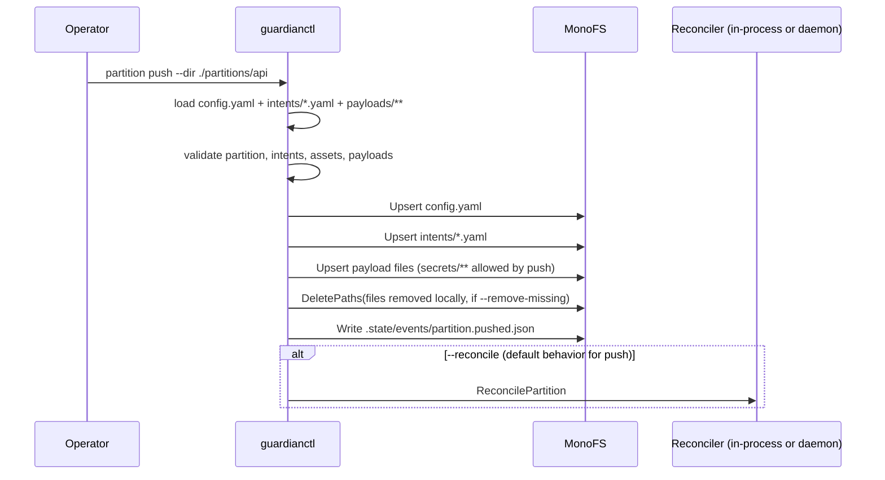

Implementation details:

- `loadLocalPartitionBundle` reads `config.yaml` or `partition.yaml`, all
  `intents/*.yaml|yml`, `payloads/**`, and an optional `secrets/` directory.
- Names are validated; relative payload paths are resolved against the
  partition directory. Symlinks are followed.
- `--remove-missing` defaults to `true` for push, which means a local deletion
  becomes a remote deletion. This is a destructive default.
- The `partition.pushed` event is written before the manifest batch, so a
  failed write can still leave a success event.
- A push that changes only payload bytes produces no rollout diff (the diff is
  computed from intent manifests), although the reconciler may still queue
  work if the spec hash changes.

### 1.3 UI bundle save flow

1. `PUT /api/partitions/{name}/bundle` accepts a JSON envelope with config
   text, intent documents, and optional deletes.
2. The server checks that intent names are non-empty and unique, but does not
   validate names against the partition name regex.
3. It writes `config.yaml` and each intent via `paths.IntentManifest`, then
   emits an event.
4. If `DisableAutoDeployOnIngest` is false (default), it calls
   `ReconcilePartition` immediately.
5. The partition detail cache is invalidated.

The endpoint has no body-size limit and no in-handler authorization; see
[security](security-architecture.md).

### 1.4 Repo import flow

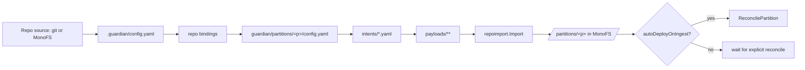

Two importers exist:

- `internal/repoimport.Import` (shared by the daemon loop): handles config
  normalization, optional `partitionPath` override, duplicate-intent checks,
  and refuses inline secrets.
- `cmd/guardianctl/repo_cmd.go` and `internal/ui/registry.go` have their own
  import variants with different filtering and secret handling.

The shared importer now prunes files recorded in
`/partitions/
/.state/repo-import.json` by the same source when they are no
longer present in the repo. Files owned by another source are preserved.
Removing an entire partition still requires an explicit delete.

---

## 2. Reconcile cycle

### 2.1 Trigger sources

| Trigger | Code | Behaviour |
|---|---|---|
| Startup | `Reconciler.Run` | Initial full `ReconcileAll`, then schedule discovery |
| Full periodic cycle | daemon `--reconcile-interval` (default 10m) | Each partition schedule; not a single global loop |
| Per-partition interval/cron | `spec.reconciliation` | Quartz job per partition |
| File watcher | `internal/orchestrator/watcher` | Debounced per-partition reconcile on config/intent changes |
| Post-reconnect | `cmd/guardiand/main.go` | Full reconcile before resuming watch |
| API/CLI | `/api/partitions/{name}/reconcile`, `partition reconcile` | Immediate synchronous reconcile |
| Force apply | `/api/partitions/{name}/reconcile?forceApply=true`, `partition reconcile --force-apply` | Queues APPLY directly |

### 2.2 Per-partition reconcile sequence

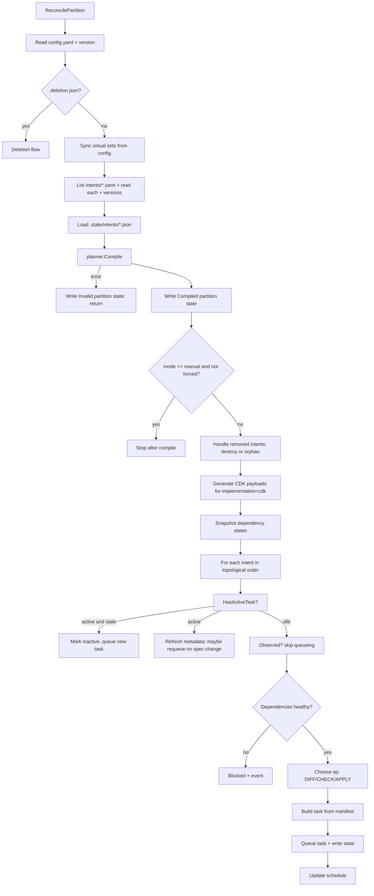

### 2.3 Operation selection

For an idle intent:

1. Compute whether the current spec hash equals the last applied hash.
2. If `forceApply`: `APPLY`.
3. Else if the spec changed since last apply, or the status is `Drifted`,
   `ApplyFailed`, or `CheckFailed`: `CHECK`.
4. Else: `DIFF`.

`CHECK` is therefore the "preflight" gate after a desired-state change; it is
not run on every cycle.

### 2.4 Concurrency and ordering

- Intents are processed in join-graph topological order.
- Assets inside a task are ordered by `dependsOn`.
- The dispatcher serializes state writes per partition with a local mutex.
- The daemon's priority pool bounds concurrent partition reconciles; the result
  processor uses 8 partition-affinity workers to preserve per-partition result
  order.
- There is no global lock or leader election. Two replicas can reconcile the
  same partition concurrently and overwrite each other's state.

### 2.5 Removed intents

When an intent exists in state but not in the manifest list:

- `deletionPolicy: destroy`: queue a DESTROY task built from the latest
  archived manifest (or the live state if no archive exists). The intent moves
  to `Destroying`; when the DESTROY result succeeds it moves to `Destroyed`.
- `orphan`: delete the intent state and forget it; the underlying resources are
  left in place.

If a DESTROY result is lost, the next deletion reconcile treats the task as
dead after `staleTaskAfter` and queues a fresh DESTROY. This prevents the
partition from being wedged by a crashed pusher.

---

## 3. Task lifecycle

### 3.1 Queue, claim, execute, result

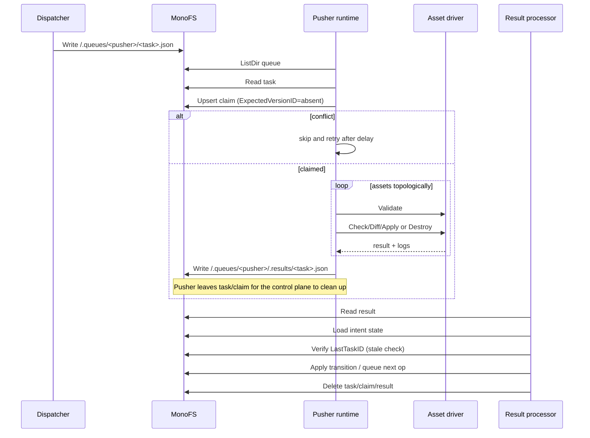

### 3.2 Claims and leases

- Claim file: `/.queues/<pusher>/.claims/<taskID>.json`.
- Creation uses `ExpectedVersionID: "absent"` (CAS). A conflict means another
  worker won.
- Lease: 300 seconds, renewed every 100 seconds with CAS on the current claim
  version.
- If renewal fails, the heartbeat stops but execution continues. After lease
  expiry another worker may delete the expired claim and claim the task.
- A task with a zero `claimedAt` or non-positive lease never expires
  (`claimExpired` returns false).
- Sharding is by task-ID hash; a worker only considers tasks in its shard.

### 3.3 Execution semantics

- Drivers are looked up by asset type. Missing driver -> task failure.
- Each driver may implement `Validate`, then `Check`, `Diff`, `Apply`, or
  `Destroy`. The runtime calls the operation requested by the task; it does not
  itself run DIFF before APPLY.
- Assets execute sequentially in dependency order. An asset failure aborts the
  remaining assets in that task.
- Outputs are accumulated as raw keys and `asset.`-prefixed keys.
- Secret asset `value` outputs are replaced with `******` before the result is
  written; `valueHash` remains for drift detection and known secret values are
  scrubbed from logs/errors.
- Results include drift, health, apply readiness, per-asset observations,
  errors, and logs.
- The dispatcher also writes an immutable task-spec copy under
  `.state/tasks/<taskID>.json`; queue files are still deleted after processing.

### 3.4 Result processing state machine

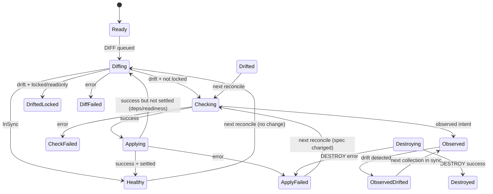

Notes:

- `CHECK` success queues APPLY directly, even in readonly partitions. Readonly
  is only enforced in the DIFF branch.
- A DIFF that is "settled" but whose apply readiness is blocked queues another
  DIFF, not CHECK.
- An APPLY that is not settled queues DIFF to wait for dependencies/readiness.
- On APPLY failure with a spec change since the last apply, a rollback is
  recorded unless the task was a forced apply.
- A successful APPLY writes state, archive, release, and a `deploy.completed`
  event, then queues dependents.

### 3.5 Queue cleanup and stale artifacts

The result processor deletes the task, claim, and result. The daemon also runs
a safety scan every 15s while tasks are live (2m when idle):

1. List `.results` per pusher.
2. For each result, check whether the intent still tracks that task.
3. Process live results that were missed by the watcher.
4. Delete orphan results whose task file is gone.

This scan is the recovery path for results that were written but whose watch
event was missed. It cannot recover a result that a crashed worker never
wrote; that case is handled by the reconciler's stale-task timeout.

---

## 4. Compile flow in detail

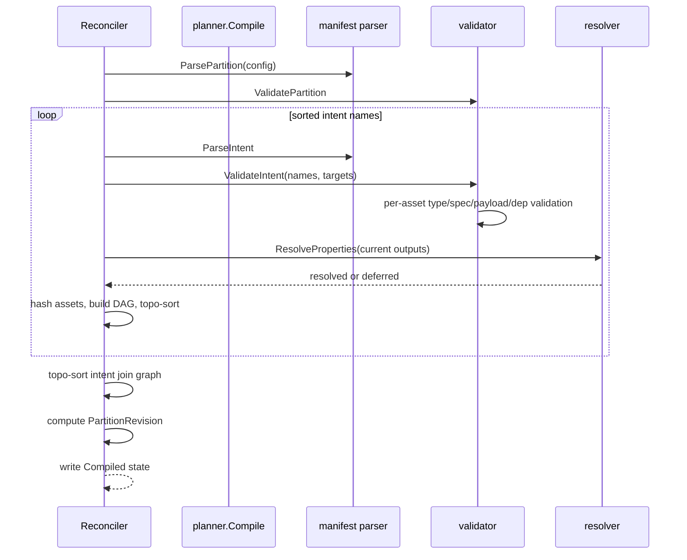

Key semantics:

- Intent names are derived from the filenames (`intents/<name>.yaml`); a
  mismatch with `metadata.name` is fatal.
- Unknown asset types are rejected.
- Duplicate asset names inside an intent are rejected.
- `dependsOn` must reference an asset in the same intent.
- Payload paths must be absolute logical paths; existence is checked by the
  validator, but the path is not required to live under the partition.
- `${...outputs...}` references are resolved from current intent outputs. If
  the referenced asset has not reported yet, the reference stays unresolved and
  the compile still succeeds; task build may later fail or the driver may
  reject it.
- `skip: true` removes an asset and its dependency edges. The planner's
  single-pass skip handling can differ from the task builder's two-pass
  handling for forward references.
- CDK intents get a synthetic `GeneratedStack` asset at task build time; the
  synthetic Observability asset is added at compile time but not at task build
  time, which is a known inconsistency.

---

## 5. Deletion flow

### 5.1 Requesting deletion

`partition delete <name>` (CLI) or `DELETE /api/partitions/{name}` (UI):

1. Verifies the partition config exists.
2. Writes `.deletion.json` with the requested policy, requester, and timestamp.
3. Triggers reconcile (CLI) or `RequestPartitionDeletion` + reconcile (UI).

`--force` in the CLI bypasses the marker and recursively purges the partition
immediately. That path does not emit a deletion event and does not run DESTROY.

### 5.2 Deferred destroy (policy `destroy`)

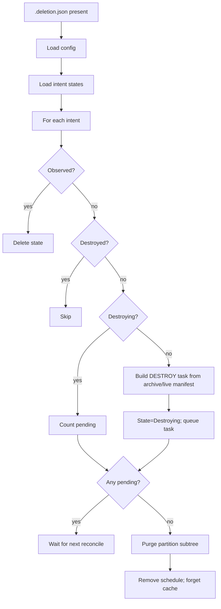

- DESTROY tasks are built from the archived manifest if available; this is the
  only way to destroy resources whose desired state has been removed.
- Queue cleanup sweeps every pusher queue for tasks targeting the partition.
- Purge deletes every file under `/partitions/
` in one batch.

### 5.3 Orphan (policy `orphan`)

Delete intent states, purge the partition subtree, remove the schedule. No
DESTROY tasks. Underlying cloud/cluster resources remain.

### 5.4 Problems

- `Destroying` is never aged out, so a lost DESTROY result wedges purge.
- The watcher ignores `.deletion.json`, so deletion is not immediate on all
  paths.
- Forced purge can race late tasks that recreate resources.

---

## 6. Rollout, release, archive, rollback

### 6.1 Successful apply

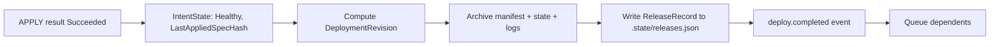

- `DeploymentRevision = hash(partitionRevision, intentVersionID, finishedAt)`.
- Archive path: `/.archive/<partition>/<intent>/<deploymentRevision>/`.
- Release log is the authoritative "latest release per intent"; the archive is
  the historical detail.
- The release log write is a read-modify-write with no CAS; concurrent replicas
  can lose records.

### 6.2 Self-healing and rollback

- If the previous `LastAppliedSpecHash` equals the current hash, the apply is
  marked `SelfHealing` (drift correction of the same spec).
- If an APPLY/CHECK/DIFF fails while the spec hash differs from the last
  applied hash, the processor records a rollback (`RollbackTo` = previous
  deployment revision) and preserves the failed spec for retry.
- `Rollback` on the release record is derived from `state.RollbackTo`.
- A forced apply skips rollback recording.

### 6.3 Explicit rollback

`guardianctl partition rollback --partition 
 --tag <tag>`:

1. Derive the tag from archived asset versions.
2. Find archived intents matching the tag.
3. Write their manifests back to `/partitions/
/intents/`.
4. Optionally reconcile/wait (CLI flags).

This is not a full snapshot restore: it only overwrites intents that existed in
that tag and leaves newer intents in place. It does not validate the restored
manifests before writing them.

### 6.4 Viewing history

`GET /api/partitions/
/history`, `/rollouts`, and the CLI `partition status`
read from:

- the release log (fast path for the latest record),
- the deployment archive (full history),
- events under `.state/events`.

`internal/historyquery` implements the join; it currently scans all archives
for rollout views and has an unused archive-index path.

---

## 7. Observed intents (AWS)

### 7.1 Generation

Three routes produce observed state:

1. **Scan + awsgen** — inventory → partition draft (`aws scan --push`).
2. **Assembly + observedgen** — a CDK cloud assembly → observed/managed intents
   (`aws observed-generate`).
3. **Onboarding** — SSM descriptors → observed partitions (`onboardInterval`).

### 7.2 Collection

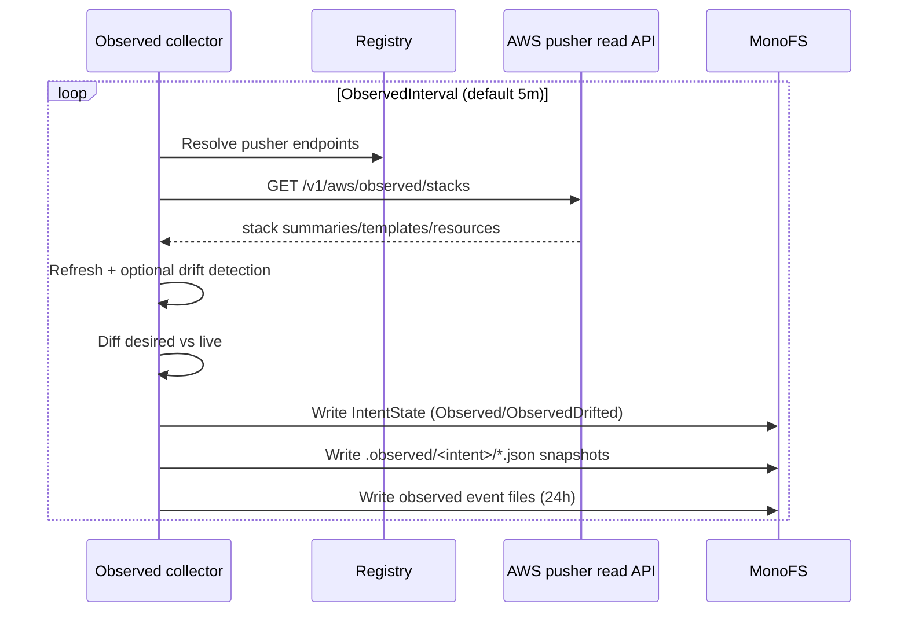

Observed intents are excluded from task queueing by the reconciler and reject
APPLY results defensively. Their resource inventory is stored in
`IntentState.Resources` and rendered in the UI.

### 7.3 awsobserve cache

The AWS pusher can also maintain an in-memory observed cache:

- EventBridge CloudFormation events → SQS → `awsobserve.Consumer`.
- `Cache` stores stack summaries by account/region/name.
- `Refresher` supplements with `DescribeStacks`, drift detection, templates,
  and resource maps.
- `Service` serves `/v1/aws/observed/*` and can diff uploaded source or run
  `cdk synth`.

The cache is not persisted; a pusher restart loses it until refresh.

---

## 8. AWS account scan flow

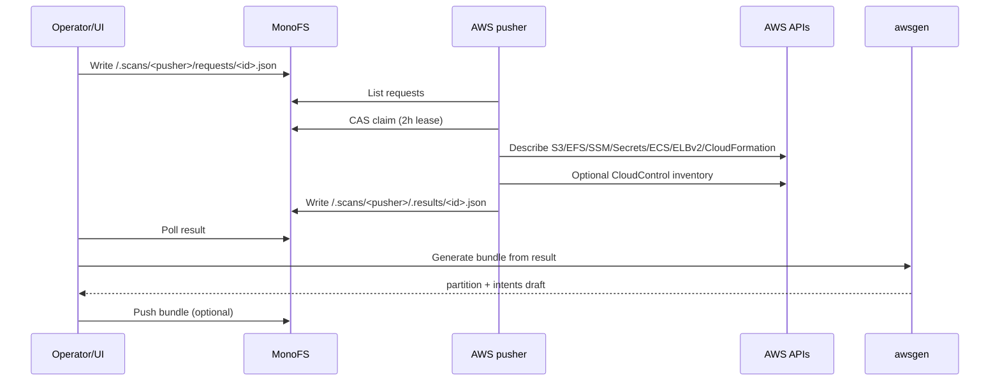

Scan details:

- Request includes pusher, account, regions, service types, stack selectors,
  grouping, and inventory flag.
- The scanner is read-only; it never mutates AWS.
- `awsgen` maps six resource kinds to assets and can group by stack or by
  resource.
- Scan secrets: plain SSM `String` values and ECS environment values are copied
  into the result and then into generated `Config`/`Compute` assets. Treat scan
  results as sensitive.

---

## 9. Onboarding and unmanaged adoption

### 9.1 Onboarding descriptors

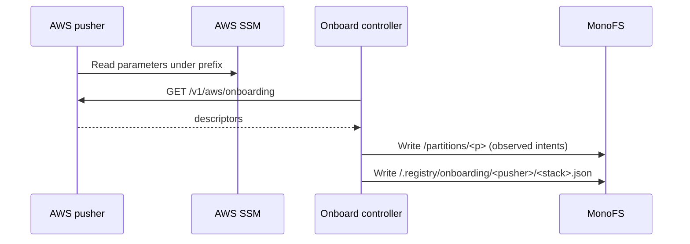

- Descriptors declare partition, repo, account/region, and stack selectors.
- The controller republishes all descriptors every interval; there is no lease
  or change detection.
- `Descriptor.Repo` is parsed but unused.

### 9.2 Unmanaged stacks

1. List all CloudFormation stacks in scope.
2. Filter out stacks already managed by a partition (by tags/naming).
3. Classify against repo bindings.
4. `associate` registers the repo, publishes a review branch with a proposed
   partition, and records the association.
5. Detection refreshes every stack on every call (expensive).

If publishing fails, the repo is already registered, so a subsequent detection
can treat the partition as bound and stop reporting it. The CLI still returns
success.

---

## 10. Probe flow

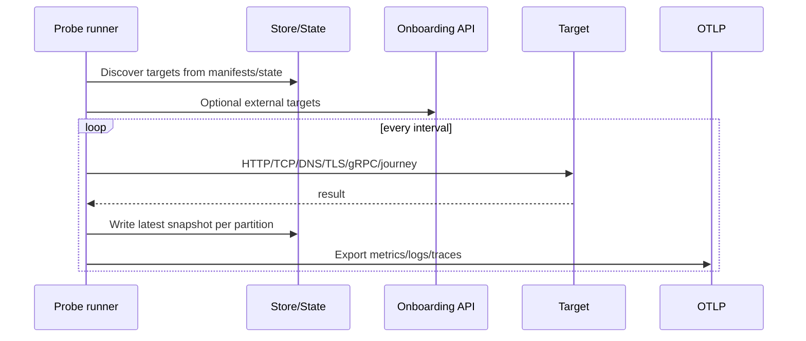

- Probe definitions live in `Probe` assets; partition defaults can add HTTP
  paths/TCP ports and limits.
- Journeys are multi-step request sequences with extraction and assertions.
- `AllowExternal` controls whether non-cluster targets are allowed.
- There is no probe history in MonoFS; history is in telemetry.
- The documented storeless mode can panic because snapshot writing dereferences
  a nil store.

---

## 11. Access policy flow

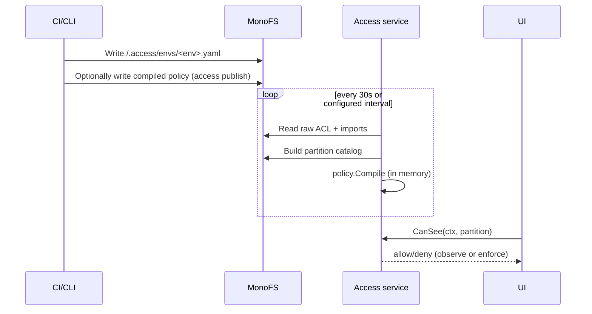

- Disabled: no raw path -> everything visible.
- Observe: denials are logged, nothing filtered.
- Enforce: reads filtered; if no policy ever loaded, non-admin reads fail
  closed.
- `CanModify` exists but has no callers. Mutating UI endpoints do not check it.
- The CLI writes directly to MonoFS and bypasses this entire flow.

---

## 12. Alerting flow

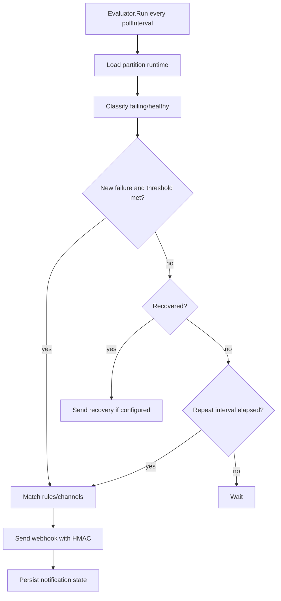

- State per partition: `notifications.json`.
- Defaults: 30s poll, 15m cooldown, 6h repeat.
- Webhook signature is `HMAC-SHA256(body)` with no timestamp or nonce.
- Partial channel success is treated as delivered; retry waits for the repeat
  interval.
- In HA, replicas race on the notification state file.

---

## 13. Image build and release flow

Details:

- `images.yaml` describes repository, Dockerfile, build context, args,
  platforms, and dependencies.
- Building resolves build args in file/sequence order; it is not a DAG, so
  out-of-order dependencies require reordering the file.
- `image stamp` only writes `ImageBuild` assets that have a matching state
  entry with a non-empty tag. It does not resolve `${...}` placeholders.
- `image release` now calls the same `buildImages`, `pushImages`, and
  `stampImages` helpers as the individual commands, so tags/build args/stamping
  cannot drift. An image whose tag cannot be resolved is an error rather than a
  silent `latest` fallback.
- `aws ecr-login` is the only registry authentication helper.

---

## 14. Authentication and connection flows

### 14.1 CLI discovery

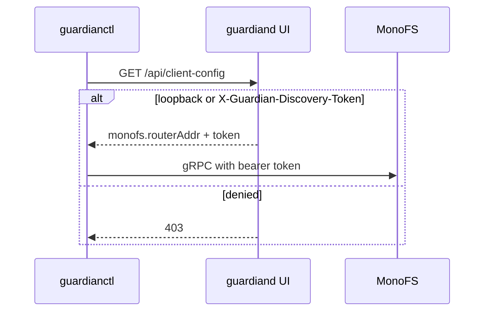

If no configuration is present, the CLI falls back to
`127.0.0.1:9090` / `guardian-dev-token`. This is convenient for development and
dangerous for production.

### 14.2 OIDC device login

`guardianctl auth login` performs an OIDC device authorization flow, caches the
token in `~/.config/guardianctl/token.json`, and attaches it to MonoFS gRPC
metadata. The token helper does not refresh and ignores JWT expiry/audience.

### 14.3 Browser login

When OIDC verification is enabled and a client secret + redirect URL are
configured, `guardiand` mounts `/auth/login`, `/auth/callback`, and
`/auth/logout`. Identity is resolved from the `monofs_session` cookie or a
bearer token. `MONOFS_AUTHZ_ENFORCE_UI=true` turns the login wall on; by default
it is observe-only.

### 14.4 Control-plane deploy authorization

`--authz-enforce-deploy` loads grants from a JSON file or inline JSON and wraps
partition reconcile with a maintainer/admin check. Anonymous identities are
explicitly allowed (trusted automation), and a load error disables enforcement
rather than failing closed.

---

## 15. UI read and polling flow

1. `GET /api/overview` loads all partition summaries (access-filtered) and
   builds dashboard cards.
2. `GET /api/partitions/{name}` loads config, intents, state, assets, topology,
   assignments, and latest deployments, then compiles the manifests to enrich
   the view.
3. The browser polls overview every 20s (1–120s user setting; faster during
   transitions; 3x slower when the tab is hidden).
4. Rollouts poll at 3x the overview interval; scans poll every 3s while
   pending.
5. Server caches: partition detail 3s, rollouts 1m, projections TTL + store
   watch. There is no cross-replica invalidation, so a replica can serve a
   stale detail view after another replica writes.

The UI performs full-detail aggregation for every partition in the overview.
At fleet scale this is the dominant read cost.

---

## 16. End-to-end example: change a service image

1. Operator runs `guardianctl image build --dir ./partitions/api`, then
   `image push`, then `image stamp`.
2. `image stamp` rewrites `Compute.properties.image` (or `ImageBuild.version`)
   in `intents/api.yaml`.
3. `partition push --dir ./partitions/api` validates and writes config,
   intents, and payloads. It emits `partition.pushed`.
4. The watcher sees `intents/api.yaml` and debounces a reconcile.
5. The reconciler compiles the partition. The intent spec hash changes; the
   chosen operation is `CHECK`.
6. The pusher claims the CHECK task, validates the target,
   pulls the image or verifies it exists, and reports readiness.
7. The result processor queues `APPLY` and updates state to `Applying`.
8. The pusher applies the new image, waits for rollout health, and reports
   outputs/health.
9. The result processor marks the intent `Healthy`, computes a deployment
   revision, archives the manifest/state/logs, updates `releases.json`, emits
   `deploy.completed`, and queues dependents.
10. The UI overview shows the new release; `partition history` and rollouts
    read the archive and release log.

If the apply fails:

- state becomes `ApplyFailed`;
- if the spec changed from the last applied hash, a rollback record is written
  (`RollbackTo` previous revision);
- the next scheduled reconcile retries CHECK, then APPLY;
- an operator can inspect logs via `GET /api/partitions/
/intents/<i>/activity`
  or `partition status`, fix the image, and push again.
