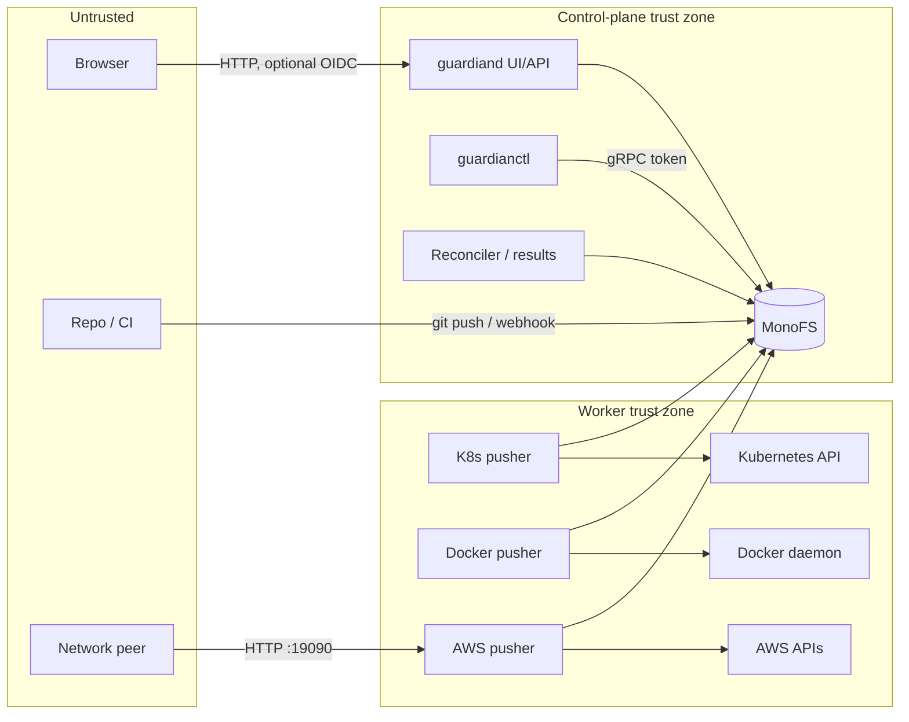

# Guardian Security Architecture

Status: regenerated from source, October 2026.
Companion to [Architecture](architecture.md) and [Logical flows](logical-flow.md).

This document describes the security properties the code actually has, the
trust boundaries it assumes, and the gaps between those assumptions and a
production-hardened design. It is written for operators and reviewers; it is
not a compliance attestation.

The P0+P1 mitigation pass is recorded in
[Changes applied](internal/changes.md). Residual risk is called out per threat.

---

## 1. Security objectives

Guardian is a deployment control plane, so its primary security objective is
**integrity of desired state and task execution**. Confidentiality matters
because desired state and task results can contain secrets. Availability
matters because a stuck reconciler stops deployments but does not, by itself,
delete infrastructure.

The intended properties are:

1. Only authorized humans/automation can change a partition.
2. A pusher can only execute tasks for the target it owns.
3. Secret values are not persisted in readable state, logs, or results.
4. Network-exposed APIs require authentication and transport protection.
5. Cloud credentials are scoped to the account and actions a deployment needs.
6. Every mutation is attributable and auditable.
7. A compromise of one tenant/repo does not grant control of another.

The current implementation satisfies (6) partially (principal/correlation
metadata is attached) and (1)–(5), (7) only conditionally. The gaps are listed
in §9 and cross-referenced to the internal findings.

---

## 2. Trust boundaries and actors

Trust boundaries:

| Boundary | What crosses it | Current control |
|---|---|---|
| Browser → `guardiand` | Bearer/session identity, mutations | OIDC verification in observe mode; optional login wall; no per-route authz |
| CI/repo → MonoFS | Desired-state YAML, access policy | MonoFS token/principal; no signature on `repo notify` |
| `guardianctl` → MonoFS | Desired state, registry, tasks | MonoFS bearer token; no Guardian-side authorization |
| `guardiand` → MonoFS | All runtime state, queues | MonoFS token; writable control-plane role |
| Pusher → MonoFS | Task claims/results, state registration | MonoFS token; pusher can write any Guardian path its token allows |
| Doctor/Grafana → AWS pusher `:19090` | Queries, observed state, source uploads | Static bearer token; empty token disables auth |
| AWS pusher → AWS | IAM/CFN/service calls | Assumed role `GuardianCdkDeployRole`; ambient SDK credentials for some paths |
| Pusher → target cluster/host | Workloads, volumes, secrets | Cluster RBAC, Docker socket (host root equivalent) |

The boundary that is most often assumed but not enforced is **MonoFS itself**.
Anyone holding the guardian token can write any partition, registry record, or
queue file. Guardian's authorization logic sits above the store, not inside it.

---

## 3. Identity and authentication

### 3.1 MonoFS token and principal

Every Guardian process that talks to MonoFS presents a bearer token and a
principal ID:

- `guardiand`: `monofs.token`, principal `guardian` / configured ID, role
  `control-plane`.
- `guardianctl`: `--monofs-token`, principal `guardianctl`.
- Pushers: `--monofs-token`, principal `guardian-pusher-<name>`.
- `guardian-pusher-aws --observed-only`: memory store, no MonoFS.

The gRPC client uses `insecure.NewCredentials()` (`internal/store/monofs`).
Transport security is therefore whatever the surrounding network/proxy
provides; there is no TLS/mTLS in the client. The token is sent as gRPC bearer
metadata and is also used for REST-style version calls.

### 3.2 OIDC on the Guardian UI

`cmd/guardiand/main.go`:

1. Builds an OIDC verifier only when `--oidc-issuer` and `--oidc-audience` are
   both set (`MONOFS_OIDC_ISSUER`/`AUDIENCE` fallbacks).
2. If verifier construction fails, logs and falls back to `NoopVerifier`.
3. Wraps the mux with `coreauthz.NewAuthenticator(uiVerifier, nil, false)`.
   The last argument means **observe mode**: unauthenticated requests are still
   allowed through; identity is attached when present.
4. Optionally wraps with `WebAuthenticator` when an OIDC client secret and
   redirect URL are configured. Browser login is enabled; `RequireLogin` is
   only true when `MONOFS_AUTHZ_ENFORCE_UI=true`.

Consequences:

- Default: anyone who can reach the UI can read and mutate.
- With `MONOFS_AUTHZ_ENFORCE_UI=true`: `/api/m2m/*` and `/api/access/policy`
  are login-exempt; `/api/m2m/overview` and `/api/m2m/partitions*` also lack
  their own M2M check, so they remain anonymous.
- `/api/client-config` is not login-exempt, so enabling the login wall can
  break token-based CLI discovery (the CLI sends a discovery token, not a
  browser session).

### 3.3 CLI authentication

Two independent tracks:

1. **MonoFS token** — the actual store credential (`GUARDIAN_MONOFS_TOKEN` or
   discovery).
2. **OIDC device flow** — `guardianctl auth login` caches an ID/access token in
   `~/.config/guardianctl/token.json` and attaches it to gRPC metadata.

The cached token helper does not refresh, prefers the ID token while checking
the access-token lifetime, and does not validate JWT `exp`/audience. Treat it as
an identity hint, not a short-lived credential.

### 3.4 Machine-to-machine (M2M)

- `/api/m2m/pushers*` and `/api/m2m/federation/partitions` use
  `requireM2MAccess`: internal token, admin role, or loopback.
- `/api/m2m/overview` and `/api/m2m/partitions*` do **not** call
  `requireM2MAccess`.
- The AWS pusher read API uses a single static bearer token; an empty token
  means no authentication at all.
- There is no mTLS, token rotation, or per-caller scope anywhere in Guardian.

### 3.5 Loopback trust

`/api/client-config` and several M2M paths treat `RemoteAddr` being loopback as
sufficient authorization. Behind a local reverse proxy, every remote user
appears as loopback. The check does not consult `X-Forwarded-For` or a trusted
proxy configuration.

---

## 4. Authorization

### 4.1 Control-plane deploy guard

`internal/authz.Guard` wraps partition reconcile when
`--authz-enforce-deploy` is set. It:

- loads grants from a JSON file and/or inline JSON;
- checks `ActionModify` for the partition;
- returns nil when enforcement is off, the evaluator is nil, the partition is
  empty (error path), or the request has no/anonymous identity.

The anonymous bypass is intentional for trusted automation, but it means the
guard is **not an authentication boundary**: omitting the `Authorization`
header bypasses it. Loading errors are logged and disable enforcement rather
than failing startup.

### 4.2 Access policy

`internal/access` compiles a repo-managed ACL from `/.access/envs/<env>.yaml`
against the live partition catalog.

| Mode | Raw path | Enforce | Behaviour |
|---|---|---|---|
| Disabled | empty | any | Everything visible/modifiable |
| Observe | set | false | Denials logged; nothing filtered |
| Enforce | set | true | Reads filtered; no policy -> non-admin reads denied |

Implemented decisions:

- `CanSee` — used by the UI for partition GETs and overview filtering.
- `CanModify` — used by `Server.authorizeMutation` for every partition-scoped
  mutation (bundle save, delete, reconcile, validate, activity).
- `IsAdmin` — used for registry/repo/set/scan/unmanaged mutations.
- `FilterPartitions` — read filtering.

Still not implemented:

- Authentication by default. Authorization only runs when an identity exists
  and the access policy is enabled; a deployment without OIDC/login and without
  an access policy remains open by network placement.
- Authorization on `guardianctl` writes (it writes directly to MonoFS).
- Authorization on pusher task execution beyond queue routing.
- Per-tenant scoping inside a single MonoFS namespace.

### 4.3 Authorization matrix (current)

`authorizeMutation` runs before the UI mux. It is permissive when the access
policy is disabled, and permissive in observe mode.

| Operation | UI auth | access.CanSee | access.CanModify/IsAdmin | Control-plane guard | MonoFS token |
|---|---|---|---|---|---|
| Read partition | Observe-mode OIDC | Yes | — | — | — |
| Save bundle | Observe-mode OIDC | No | `CanModify` | No | Required indirectly |
| Delete partition | Observe-mode OIDC | No | `CanModify` | No | Required indirectly |
| Reconcile | Observe-mode OIDC | No | `CanModify` | Yes (optional, anonymous bypass) | Required indirectly |
| Register pusher/repo | Observe-mode OIDC | No | `IsAdmin` | No | Required indirectly |
| Create scan/set/unmanaged association | Observe-mode OIDC | No | `IsAdmin` | No | Required indirectly |
| Read pusher token | Observe-mode OIDC | No | Permissioned by network/token | No | — |
| M2M overview/partitions | M2M token/admin/loopback | — | `requireM2MAccess` | — | — |
| CLI partition push | None | No | No | No | Yes |
| Pusher claim/result | None | No | No | No | Yes |

The remaining exposure is authentication: an anonymous caller on a deployment
with no login wall is still anonymous. The mutation guard prevents a
low-privilege *authenticated* user from editing a partition they cannot see,
and prevents self-service registry changes unless the policy says otherwise.

---

## 5. Secrets

### 5.1 Where secrets live

| Secret | Storage | Exposure |
|---|---|---|
| MonoFS token | Config file, env, entrypoint temp config, `/api/client-config` | Process argv in containers, world-readable temp file, UI endpoint |
| OIDC client secret | Env (`MONOFS_OIDC_CLIENT_SECRET`) | Process env |
| Pusher observed-API token | `/.registry/pushers/*.json` (`token` or `tokenEnv`) | UI API returns it; store readers can read it |
| Repo source credentials | `Repo.Source` URL | UI/CLI list |
| Webhook signing secret | Config/env | Process env |
| AWS credentials | Ambient SDK/instance role; static env for CLI backend | Child process env (including npm) |
| `Secret` asset value | Inline in manifest or payload file | Task/state/result outputs |
| Probe auth headers | Probe asset properties | Task/state |
| Compliance S3 credentials | AWS default chain | — |

### 5.2 Secret asset behaviour

- Inline `properties.value` is stored in the intent manifest in MonoFS. The UI
  redacts it in manifests and asset documents; a redacted round-trip is
  restored from the stored manifest before saving.
- Secret drivers emit `valueHash` for drift detection. The runtime redacts
  `value`/`asset.value` before writing the task result and scrubs the value from
  logs/errors; the result processor redacts again before state/archive writes.
- Kubernetes still injects resolved secrets as literal environment values in
  the pod spec (no `Secret` object, no `secretKeyRef`, no `imagePullSecrets`).
- Docker still passes secrets as `-e KEY=VALUE` on the CLI, exposing them in
  process argv and `docker inspect`; config/inline files are written `0644`.
- AWS Secrets Manager values are redacted in outputs; the `Secret` Destroy
  operation is still a no-op.
- Config assets with `SecureString` SSM parameters do not converge because
  reads omit `WithDecryption` while diffs compare plaintext.

### 5.3 Redaction

- UI `data.go` masks Secret `value` in outputs, manifests, and asset documents;
  `secretRef` remains visible.
- Task results and intent state no longer persist plaintext Secret values; the
  `valueHash` remains for drift detection.
- Task queue files still contain the secret while in flight (the pusher must
  read it). Logs are scrubbed for known secret values at result write time.
- There is still no general reference-only model: asset properties can carry
  plaintext, and provider-side resolution is not implemented.

---

## 6. Data protection and transport

### 6.1 Transport

| Link | Transport | Protection |
|---|---|---|
| Browser ↔ `guardiand` | HTTP | None by default; no TLS, HSTS, or secure-cookie enforcement in Guardian |
| `guardiand` ↔ MonoFS | gRPC | `insecure.NewCredentials()`; token in metadata |
| Pusher ↔ MonoFS | gRPC | Same |
| Doctor ↔ AWS pusher | HTTP `:19090` | Static bearer token; no TLS |
| AWS pusher ↔ AWS | HTTPS | AWS SDK TLS |
| Webhook | HTTP/HTTPS | HMAC signature; no timestamp/nonce |
| `guardiand` ↔ OTLP collector | gRPC | `Insecure` defaults true in telemetry config |

### 6.2 At rest

- MonoFS is the system of record; encryption at rest is a MonoFS/deployment
  concern, not enforced by Guardian.
- The compliance publisher copies state/archive objects to S3 but does not set
  SSE/KMS, Object Lock, or retries. Errors are dropped.
- The local FS store writes files `0644` and keeps every version forever.
- Bootstrap-generated token files are `0644`; shared encryption keys are
  `0644`.
- Kubernetes `Secret` assets become plain env values in Deployments, so they
  are stored in the pod spec and etcd as ordinary strings.

### 6.3 Audit

- Mutations carry `PrincipalID`, `Reason`, and `CorrelationID` in the MonoFS
  mutation context.
- Task results and state include task IDs and timestamps.
- Task specs are deleted after processing and are not archived, so the exact
  executed payload is not reconstructible from the archive.
- The UI exposes events and deployments, but there is no tamper-evident audit
  log and no guaranteed retention.

---

## 7. Network exposure

| Listener | Default | Auth | Notes |
|---|---|---|---|
| Guardian UI/API | `guardian.uiListenAddress`; bootstrap uses `:8090` | OIDC observe-mode; optional login wall | Serves `/metrics` unauthenticated; static directory listing under `/static/` |
| AWS read API | `127.0.0.1:19090` (loopback default) | Static token; empty disables auth (warned if non-loopback) | Plaintext HTTP; no timeouts |
| Pusher metrics/OTLP | exporter-dependent | Usually none | Depends on collector configuration |
| MonoFS | deployment-specific | Token | Outside Guardian's code |

The AWS read API is the most exposed component: it is a read surface over
CloudWatch, X-Ray, CloudFormation templates, and probe data, and it also exposes
`/v1/aws/observed/diff`, which runs `npm install` and `cdk synth` on
caller-supplied source. An unauthenticated or weakly authenticated caller can
cause compute spend, read telemetry across the account, and execute code in the
pusher.

---

## 8. Supply chain and execution safety

### 8.1 Images

- All Guardian images run as root; none declares `USER`.
- The Docker pusher mounts `/var/run/docker.sock` and runs with
  `--network host` in bootstrap. Docker socket access is host-root equivalent.
- Drivers can create privileged/capability-added containers from asset
  properties.
- No seccomp, AppArmor, read-only root filesystem, or capability drop is set.

### 8.2 Build and release

- CI runs only `go test ./...`; there is no image build, SBOM, signing, or
  vulnerability scan in the repository workflows.
- The only release workflow deletes `go.sum`, which removes checksum
  verification for downstream builds.
- Dockerfile build args use `BUILD_VERSION`/`BUILD_COMMIT`, while
  `guardianctl image build` passes `VERSION`/`COMMIT`; images often have empty
  version metadata.
- Images default to `:latest`/`:dev` tags with `IfNotPresent`.

### 8.3 Runtime code execution

- AWS CDK backend runs `npm install`/`npm ci` and arbitrary app code from
  MonoFS with static AWS credentials in the environment. A malicious
  `package.json` postinstall script compromises the pusher's AWS identity.
- `payload.appCommand` is passed to `cdk --app` and `entrypoint` is appended
  without quoting, enabling arbitrary command execution.
- The read API's diff endpoint accepts caller-supplied source and
  `appCommand`, reaching the same code path.
- Kubernetes `K8sResource` force-applies arbitrary multi-document YAML,
  including cluster-scoped objects/CRDs; Destroy is a no-op.
- Docker `Compute` can mount host paths and add capabilities.

### 8.4 Path traversal and write scope

Several user-controlled names are joined into store or filesystem paths
without rejecting `..`:

- UI bundle save: intent names → `/partitions/
/intents/<name>.yaml`.
- CLI `--partition`, `--env`, and payload paths.
- Queue cleanup: `result.Pusher` and `result.TaskID` → delete paths.
- Observed collector: assembly dir + template/stack name.
- AWS source staging: entrypoint paths.

`paths.normalize` uses `path.Join`/`path.Clean`, which collapses `..` rather
than rejecting it. In a multi-tenant store this is a cross-tenant
read/write/delete primitive. The MonoFS adapter rejects unknown top-level
namespaces, which limits but does not eliminate the impact.

---

## 9. Threat model

| ID | Threat | Current control | Gap / impact | Severity |
|---|---|---|---|---|
| T1 | Anonymous user reaches UI and deletes/modifies partitions | Network placement; observe-mode OIDC | No handler authz; default login off | Critical |
| T2 | User with limited access modifies a partition they cannot see | `CanModify` on every UI mutation when access policy is enabled | Residual: no authn when policy/login disabled; CLI bypasses UI | High |
| T3 | Compromised pusher spoofs a result (APPLY for DIFF, arbitrary outputs) | Result validated against queued task op/partition/intent/pusher | Residual: a pusher can rewrite the task file first | High |
| T4 | Pusher result path traversal deletes other partitions | Queue identity validated; traversal names rejected at CLI/UI/repo boundaries | Residual: other name-to-path callers not audited | Critical |
| T5 | Attacker reads pusher tokens | `/api/pushers` returns token; store readable | Token grants observed API access | High |
| T6 | Attacker exfiltrates env secrets via pusher registration | `TokenEnv` + attacker `observedApiUrl` | UI can set both; observed client sends token to URL | High |
| T7 | AWS read API abused to read logs/traces/templates | Loopback default; warning on non-loopback without token | Residual: plaintext HTTP, static token, no scopes/timeouts | High |
| T8 | RCE on AWS pusher via observed diff | Token | `appCommand` + npm install; arbitrary source | Critical |
| T9 | AWS credential theft via CDK app | Assumed role | Static creds in child env; malicious package scripts | Critical |
| T10 | Secret values leak into state/results/logs | Partial UI masking | Plaintext outputs, 0644 files, argv, no redaction | High |
| T11 | Cross-tenant path traversal via names | Shared validation on UI/CLI/repo/result boundaries | Residual: observed collector and other path builders not fully audited | High |
| T12 | IAM privilege escalation via generated roles | Per-intent role | `Resource:"*"`, `iam:CreateRole/AttachRolePolicy/PassRole` | High |
| T13 | Supply-chain compromise of pusher image | None | Root, no signing/SBOM, `go.sum` deletion workflow | High |
| T14 | Denial of service by scan/refresh loops | Timeouts in some calls | Unbounded listings, 500-stack refresh, no rate limit | Medium |
| T15 | Webhook replay/forgery | HMAC body | No timestamp/nonce; secret may be in config | Medium |
| T16 | Deploy guard bypass | Optional enforce | Anonymous identity allowed; errors disable; CLI bypasses | High |
| T17 | Stale/partial listing triggers mass DESTROY | Reconcile treats missing intents as removed | MonoFS partial listings reported as success | High |
| T18 | Log/telemetry data exfiltration | OTLP endpoint config | Insecure transport by default; all stderr mirrored | Medium |

---

## 10. Security invariants to restore

These are the invariants a hardened Guardian should enforce. They are also the
acceptance criteria for the work items in
[missing pieces](internal/missing.md).

1. **Authenticate at the edge, authorize per route.** No UI mutation may
   execute without an authenticated identity and an explicit role check on the
   target partition. Default to deny.
2. **Do not ship the store credential through discovery.** `/api/client-config`
   must return a short-lived, scoped, auditable credential — or be removed in
   favor of an authenticated proxy.
3. **Make the control-plane guard fail closed.** Missing grants/evaluator must
   deny, and anonymous automation must use a distinct service identity.
4. **Validate result provenance.** The processor must verify task ID, op,
   partition, intent, and pusher against the queued task and reject mismatches.
5. **Never persist plaintext secrets.** Secret assets should carry references,
   not values; results/state/logs must redact or omit secret outputs.
6. **Reject traversal.** All names/paths derived from user or repo input must
   be validated against a strict grammar and confined to the intended prefix.
7. **Protect the read API.** Bind loopback by default, require a non-empty
   token, use TLS/mTLS, add per-caller scopes and rate limits, and remove or
   gate the source-upload/synth endpoint.
8. **Scope AWS credentials.** Require ExternalId and trust conditions, use
   permissions boundaries, grant per-resource actions, and never pass static
   credentials to package installers.
9. **Harden the runtime.** Non-root, read-only rootfs, dropped capabilities, no
   Docker socket for untrusted code, network policies, and a policy engine for
   privileged container properties.
10. **Make history immutable.** Task specs are now archived under
    `.state/tasks`; still add retention/signing, S3 SSE/KMS and Object Lock, and
    an event retention policy.
11. **Coordinate replicas.** Add leases/CAS for reconcile, result processing,
    release writes, alerting, and observed collection.
12. **Secure the supply chain.** Build reproducibly, pin dependencies, generate
    SBOMs, sign images, scan vulnerabilities, and never delete `go.sum`.

---

## 11. Operator checklist

Minimum hardening for a non-development deployment:

- [ ] Set `MONOFS_AUTHZ_ENFORCE_UI=true` and configure OIDC.
- [ ] Put the UI behind an authenticating proxy/mTLS if browser login is not
      used.
- [ ] Bind the UI to a private interface; do not expose `/metrics` publicly.
- [ ] Keep the AWS read API on `127.0.0.1:19090` or a private interface, and
      always set `--awsread-token` (prefer mTLS in front).
- [ ] Do not enable `/v1/aws/observed/diff` for untrusted callers.
- [ ] Set `GUARDIAN_AUTHZ_ENFORCE_DEPLOY=true` and provide grants; do not rely
      on anonymous automation.
- [ ] Use a MonoFS token scoped to the guardian namespace and rotate it.
- [ ] Avoid `Secret.properties.value`; use payload files or external secret
      references and restrict read access to the partition.
- [ ] Run pushers with a non-root user, read-only rootfs, dropped capabilities,
      and no host Docker socket except for the Docker pusher.
- [ ] Restrict `GuardianCdkDeployRole` with ExternalId, source-account
      conditions, and a permissions boundary.
- [ ] Enable S3 SSE/KMS and Object Lock for the compliance bucket.
- [ ] Enable network policies so only the pushers can reach MonoFS and only
      Doctor can reach the AWS read API.
- [ ] Monitor `/.registry/pushers` for unexpected `tokenEnv`/`observedApiUrl`
      changes.

These steps reduce exposure but do not fix the application-level gaps in §9.
The durable fixes are tracked in the internal findings.
